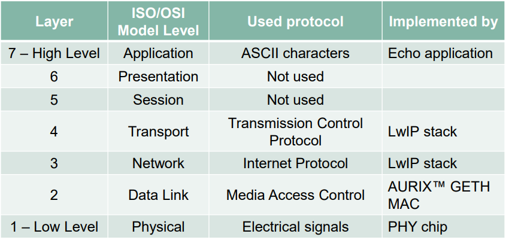
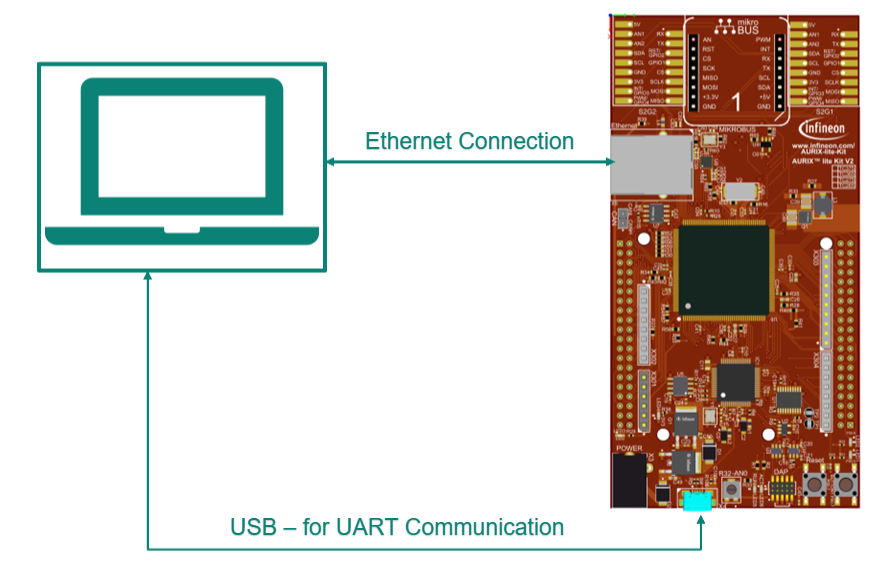
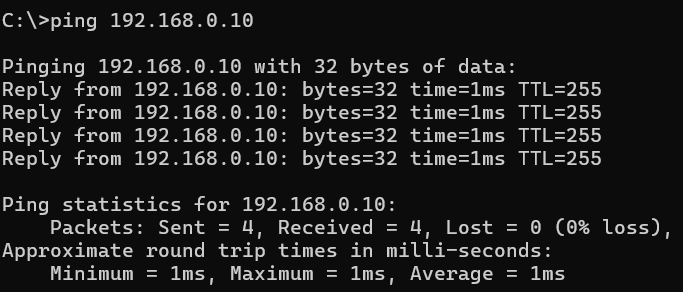
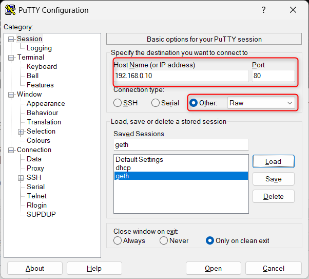
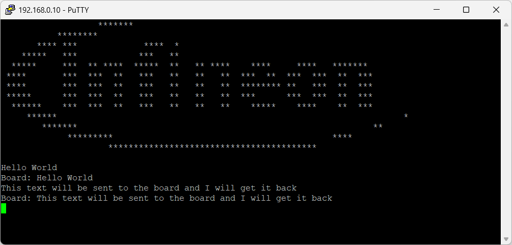

# iLLD_TC375_LK_ACS_Apps_LwIP_Echo

**The Gigabit Ethernet Media Access Controller (GETH) module and the Lightweight IP (LwIP) stack are used to implement a network echo application using ACS APPs.**

## Device

The device used in this example is AURIX&trade; TC375Tx_A-Step.

## Board

The board used for testing is AURIX&trade; TC375 Lite Kit (KIT_A2G_TC375_LITE).

## Scope of work

The lwIP TCP/IP stack exchanges strings between the board and a remote client terminal.

The DAVE-generated LWIP_GETH APP configures the board with a static IPv4 address.

The application runs a TCP echo server on port 80, returning each newline-terminated message with the prefix Board: .

## Introduction

The Gigabit Ethernet Media Access Controller (GETH) implements the IEEE 802.3 data-link layer, allowing the board to connect to a Local Area Network (LAN) through the onboard Ethernet PHY interface.

The PHY is the physical-layer transceiver connected to the GETH module. Higher-level protocols, including Internet Protocol (IP), Transmission Control Protocol (TCP), Address Resolution Protocol (ARP), and Internet Control Message Protocol (ICMP), are provided in software by the lwIP stack.

## Hardware setup

This code example has been developed for the AURIX&trade; TC375 LK (KIT_A2G_TC375_LK).

Connect the board Ethernet port directly to the PC Ethernet port using an Ethernet cable.

Connect the board USB interface to the PC for UART communication and programming.

## Implementation

The DAVE-generated `LWIP_GETH` APP initializes the Ethernet module and lwIP stack during `DAVE_Init()`. It automatically adds the required `ETHERNET_CONFIG` APP instance. `INTERRUPT_CONFIG` configures the STM interrupt that invokes `updateLwIPStackISR()`. The application logic is in `Echo.c` and is started from `Cpu0_Main.c`.

### LwIP Operation

LwIP stack functions and protocols are triggered by internal timers that must be updated regularly. The `TIMER_STM` APP triggers `updateLwIPStackISR()` every millisecond. The ISR schedules the next STM interval and calls `LWIP_GETH_Lwip_onTimerTick()` to update the lwIP timer flags.

After updating the timers, the main loop calls `LWIP_GETH_Lwip_pollTimerFlags()` to process active TCP, ARP, and Ethernet-link protocols. Received Ethernet data is passed to the lwIP raw API and handled by the echo callbacks.

### The Echo Application

The echo server uses the lwIP raw API, which is callback-driven and intended for this single-threaded `NO_SYS` configuration. `echoInit()` creates the listening TCP control block and binds it to port `80`.

- `echoInit()` listens for TCP connections on port `80`.
- `echoAccept()` allocates session state, registers lwIP callbacks, and sends the connection banner.
- `echoRecv()` queues received TCP packet buffers.
- `echoUnpack()` copies received payload into the session storage and informs TCP that the data was consumed.
- `echoSend()` queues `Board: ` followed by the received message.
- `echoSent()`, `echoError()`, and `echoPoll()` manage completed transmission, connection errors, and pending session data.
- `echoClose()` unregisters callbacks, releases session memory, and closes the TCP connection.

Each `EchoSession` stores its connection state, the associated TCP control block, queued lwIP packet buffers, and a 256-byte receive buffer. Received data is returned after a newline is received or when the receive buffer is full.

## APP(s) Used

- **LWIP_GETH** - Integrates the lwIP TCP/IP stack with the Ethernet module to enable Ethernet communication.
- **ETHERNET_CONFIG** - Automatically added by `LWIP_GETH` to configure the Ethernet module.
- **CLOCK** - Configures the system clock.
- **CPU_CORE** - Configures the CPU core.
- **TIMER_STM** - Provides the periodic tick used by the lwIP stack.
- **INTERRUPT_CONFIG** - Configures the STM interrupt that triggers the lwIP timer update.

## Compiling and Programming

Before testing this code example:

- Power the board through the dedicated power connector.
- Connect the board to the PC through the USB interface.
- Build the project using the dedicated Build button  or by right-clicking the project name and selecting **Build Project**.
- To flash the device and immediately run the program, click the dedicated Flash button .

## Run and Test

After compiling and flashing the device, perform the following steps:

- Ensure that the connections described in the Hardware setup section are established.
- Verify that the Ethernet interface is reachable from the host PC using `ping 192.168.0.10`.

  Expected result: the board responds without packet loss.

  

Perform the following steps to test the echo server:

  - Connect to the board using a protocol that supports ASCII characters. For this example, use PuTTY, which supports RAW character data.

    

  - Click **Open** to establish a network connection with the board.
  - The board sends the Infineon logo and waits for input.
  - Write any text and press Enter. The board receives it and sends it back through the network. For example, entering `Hello World` returns `Board: Hello World`.

    

## References  

AURIX&trade; Configuration Studio is available online:  
- <https://www.infineon.com/aurixconfigurationstudio>  
- Use the "Import..." function to get access to more code examples  

More code examples can be found on the GIT repository:  
- <https://github.com/Infineon/AURIX_code_examples>  

For additional trainings, visit our webpage:  
- <https://www.infineon.com/aurix-expert-training>  

For questions and support, use the AURIX&trade; Forum:  
- <https://community.infineon.com/t5/AURIX/bd-p/AURIX>  