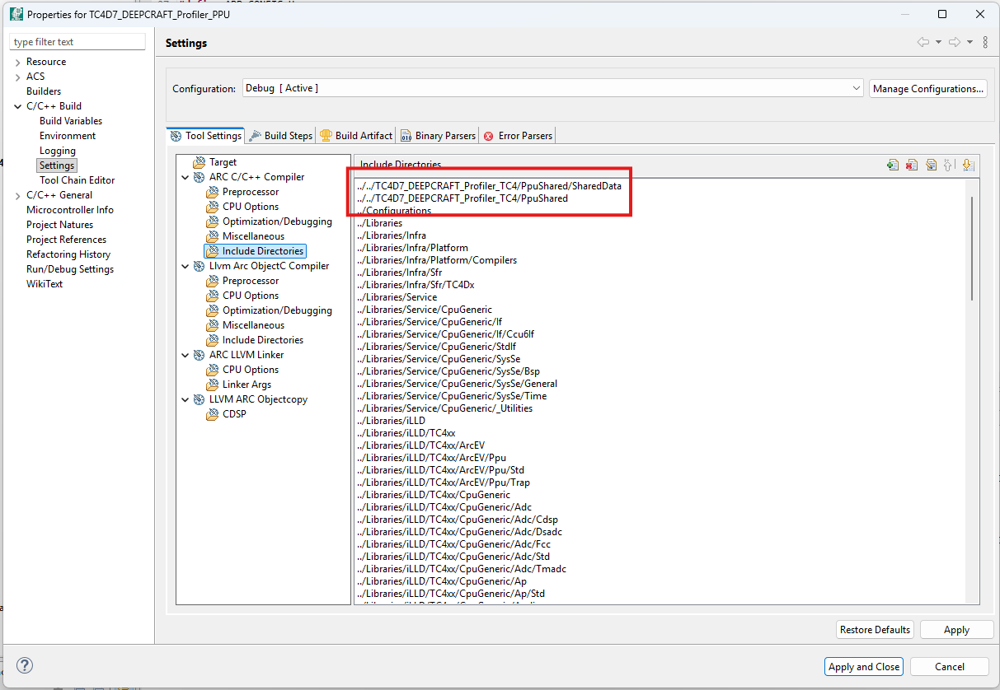
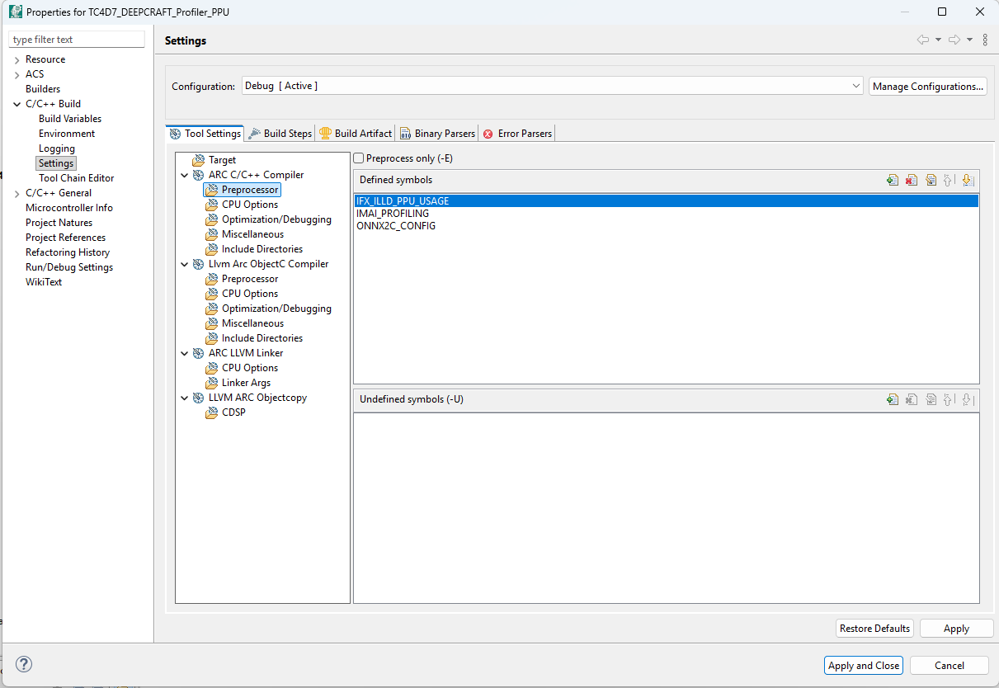
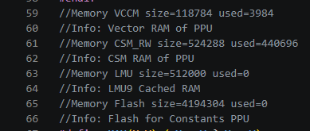
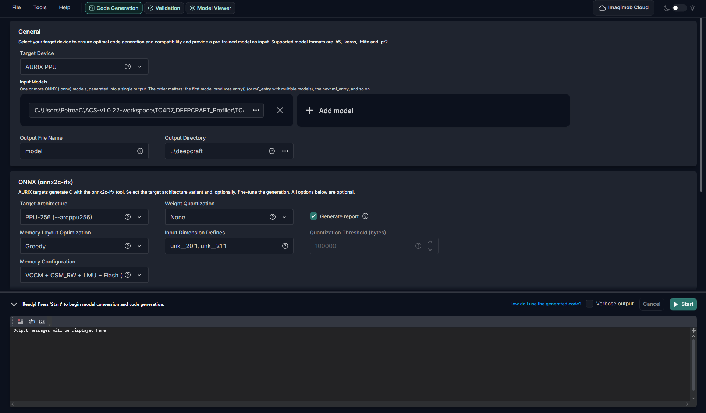
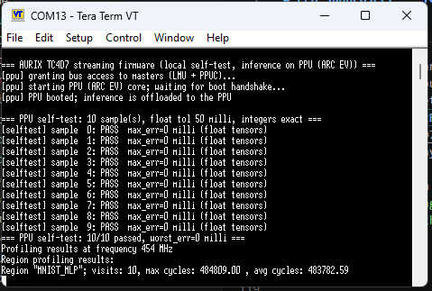

# PPU subproject — *illd_tc4d7_acs_deepcraft_ml_profiler_PPU*

**Abstract**

Example project for deploying and validating ML models on the Aurix TC4D7 Lite Kit

The Parallel Processing Unit (PPU) half of the *iLLD_TC4D7_ACS_DEEPCRAFT_ML_PROFILER*
code example for the AURIX&trade; TC4D7 Lite Kit. It builds a second, independent image
that runs on the PPU (ARC EV) core and does one job: wait for CPU0 to hand it a
model input over a shared-memory mailbox, run *IMAI_compute()*, and hand the
output back. It has no transport, no protocol and no self-test logic of its own —
all of that lives on the TriCore&trade;.

> Start with the TriCore&trade; README. It covers
> the code example as a whole: build variants, *app_config.h*, the streaming
> protocol, the local self-test, and the *tools/* scripts that build and flash
> both images. This document covers only what is specific to the PPU.

| | |
| --- | --- |
| Core | PPU (ARC EV) |
| Toolchain | ARC-LLVM clang 21, bundled with ACS, not Synopsys MetaWare |
| Artifact | *Debug/illd_tc4d7_acs_deepcraft_ml_profiler_PPU.elf* |
| Needed when | *APP_INFER* is *APP_INFER_PPU* |

With *APP_INFER_TRICORE* this image is not required at all — CPU0 then runs the
model itself and the PPU stays idle.

## Implementation

### Project structure

Only the files unique to this code example are listed below; the rest is stock
Infineon ACS scaffolding (iLLD, *Configurations/*, *Libraries/*).

```text
illd_tc4d7_acs_deepcraft_ml_profiler_PPU/
├── README.md                   This file
├── Ppu_Main.c                 *** PPU entry: IMAI_init, VCCM staging, service loop ***
├── Ppu_Aux.h                   ARC aux-register access (replaces MetaWare <speed_aux.h>)
├── Ppu_Fault.{c,h}             Exception vectors; fault record published to CPU0
├── TricoreInterface.{c,h}      PPU-side view of the shared IPC region
├── ppu.lsl                     PPU linker script (PFLASH5 / CSM / LMU / VCCM)
├── Configurations/             Per-core iLLD config
├── models/                     Reference ONNX models + validation .npz (same set as the TriCore project)
└── Source/deepcraft/           Generated ARC-vector model (`__vccm` I/O)
    ├── model.{c,h}             IMAI_* API + model metadata
    ├── model_onnx2c.c          Generated kernels and tensors
    ├── onnx2c_config.h        *** Hand-maintained tensor placement (VCCM/CSM/LMU/flash) ***
    ├── onnx2c_ppu_inline.h     Exporter-supplied inline helpers
    ├── eval_data/              Model Converter-exported validation vectors
    └── project.byom            Model Converter project descriptor
```

The cross-core contract (*app_config.h*, *ppu_ipc.h*, *SharedData.h*) is not
duplicated here. It lives in
[*../illd_tc4d7_acs_deepcraft_ml_profiler_TC4/PpuShared/*](../illd_tc4d7_acs_deepcraft_ml_profiler_TC4/PpuShared)
and this project reaches it through the include path
*../../illd_tc4d7_acs_deepcraft_ml_profiler_TC4/PpuShared*. There is exactly one copy on
purpose — two divergent copies produce two images that silently disagree about
the mailbox layout.


*Project Properties → C/C++ Build → Settings → ARC C/C++ Compiler → Include Directories: the two `../../illd_tc4d7_acs_deepcraft_ml_profiler_TC4/PpuShared...` entries this project depends on.*

### Boot

CPU0 owns the lifecycle of the PPU. *PpuInterface.c* on the TriCore&trade; side
grants bus access through *allowAccess()*, publishes the address of the shared IPC
structure, and releases the PPU from reset. The PPU then:

1. runs *crt0* from *libcrt0.a*, which builds the ARCv2 vector table at the start
   of CSM and copies the initialised sections (*.vdata*, *.csm.data*, *.data*) out
   of *PFLASH5.PPU* into their run-time memories
2. enters [*Ppu_Main.c*](Ppu_Main.c), which calls *IMAI_init()*, publishes the
   model metadata (tensor count, per-tensor sizes and element types) into the IPC
   so that CPU0 can size its own buffers, and sets the *ready* flag last
3. spins in the service loop

### Service loop

For every inference, [*Ppu_Main.c*](Ppu_Main.c):

1. waits for *g_ppuIpc.request*
2. copies the concatenated input bytes from the shared LMU mailbox into
   *s_vccmIn*
3. builds an argument vector of pointers into *s_vccmIn* and *s_vccmOut*, one per
   model tensor, in metadata order
4. calls *IMAI_compute()*
5. copies *s_vccmOut* back into the mailbox, publishes the profiling regions and
   sets *done*

The staging copies exist because the I/O of the ARC-vector export is qualified
*__vccm* (*address_space(4)*), so the buffers passed to *IMAI_compute()* have to
live physically in VCCM. The shared mailbox lives in the LMU, which both cores can
see: the PPU cannot hand a *__vccm* pointer to the TriCore&trade;, and the
TriCore&trade; cannot write into VCCM. The copies are plain byte loops, because
*memcpy()* does not take *__vccm* pointers, and they are negligible against the
run time of the model itself.

*Ppu_Main.c* refuses to run the model at all, rather than overrunning *s_vccmOut*
and corrupting neighbouring VCCM, if the model reports an output larger than
*PPU_IPC_MAX_OUTPUT_BYTES*.

### Multiple input and output tensors

Any number of input and output tensors is supported. The mailbox concatenates all
inputs and then all outputs, each starting on a *PPU_TENSOR_ALIGN* (4-byte)
boundary, in the model's own metadata order. *PpuMeta_inputOffsetBytes()* and
*PpuMeta_outputOffsetBytes()* in
[*ppu_ipc.h*](../illd_tc4d7_acs_deepcraft_ml_profiler_TC4/PpuShared/ppu_ipc.h) are the single
definition of that layout and are used by both cores, so the layout cannot drift.

> Rebuild and flash both images together whenever the shared IPC layout changes,
> that is after editing *ppu_ipc.h*, *APP_MODEL_MAX_INPUT_BYTES*,
> *APP_MODEL_MAX_OUTPUT_BYTES*, *APP_MODEL_MAX_TENSORS* or
> *APP_PPU_MAX_REGIONS*. A mismatch does not fail the build; it shows up as
> garbage data at run time.

### Building and flashing

The PPU image builds from ACS (*Project* → *Build Project*) or from the helper
script in the TriCore&trade; project, which drives both toolchains:

```powershell
cd ..\illd_tc4d7_acs_deepcraft_ml_profiler_TC4
.\tools\build_flash.ps1                 # build both, flash both, reset
.\tools\build_flash.ps1 -Target ppu     # PPU image only
```

The PPU image builds from the command line as well, because ARC-LLVM clang has no
IDE-only step. Each image is programmed with `-erase on -prog on -start off`:
`-erase on` only erases the sectors that image occupies, and the two images live
in separate flash regions (*PFLASH5.PPU* for the PPU), so they do not erase each
other. The board is restarted with an explicit DCO reset afterwards, because the
flasher's own `-start on` can leave a TC4x core halted.

> After adding or removing source files, or changing *.cproject* (include paths,
> defined symbols, exclusions), refresh with **F5** and rebuild in ACS so that it
> regenerates the managed makefiles and the *-I* response files under *Debug/*.
> Anything hand-edited under *Debug/* is build output and will be lost.

#### PPU preprocessor defines

The *Defined symbols* list of the PPU compiler has to contain:

| Define | Purpose |
| --- | --- |
| *ONNX2C_CONFIG* | Makes *model_onnx2c.c* include *onnx2c_config.h*. Without it every non-*__vccm* tensor falls back to plain C linkage and lands in *PFLASH5.PPU*, so the kernels read every weight from program flash over the SRI bus — which shows up as inferences of several hundred ms and as CPU0 dispatch timeouts |
| *IMAI_PROFILING* | Enables the per-region cycle counting. Without it the PPU reports zero profiling regions and CPU0 prints nothing |
| *IFX_ILLD_PPU_USAGE* | Selects the PPU view of the iLLD headers |

These live in *.cproject* and are easy to lose when a project is re-imported or a
build configuration is recreated. [*Ppu_Main.c*](Ppu_Main.c) fails the build with
an explanatory *#error* when *ONNX2C_CONFIG* is missing, but a missing
*IMAI_PROFILING* fails silently — if the profiling output is empty, check here
first.


*Project Properties → C/C++ Build → Settings → ARC C/C++ Compiler → Preprocessor → Defined symbols: all three required defines.*

### Memory

The PPU has four memories, mapped by the linker script [*ppu.lsl*](ppu.lsl) as
follows:

| Memory | Base | Size | Holds |
| --- | --- | --- | --- |
| *PFLASH5.PPU* | 0x81300000 | 1 MB | Code, vectors, load images of all initialised sections |
| *CSM* | 0x92080000 | 512 KB | PPU-local RAM: *.text*, *.csm.data* and *.csm.bss* tensors |
| *LMU9* | 0x90880000 | 256 KB | *.data* and *.bss*, plus the TriCore&trade;-to-PPU shared mailbox |
| *VCCM* | 0xC0000000 | 128 KB | Vector RAM: *__vccm* tensors, IPC staging buffers, both stacks |

#### VCCM is the scarce resource

In this ACS port *ppu.lsl* places both stacks in VCCM, so it has four consumers:

| # | What | Where | Sized by | Current |
| - | ---- | ----- | -------- | ------- |
| 1 | Model VCCM tensors (*.vdata* / *.vbss*) | *Source/deepcraft/model_onnx2c.c* | the memory configuration of the export | ~3.9 KB: the shipped model has no *__vccm* weight (*.vdata*), but the onnx2c *tu0*/*tu1* scratch pool (*memory_pool*, 3944 B) is *__vccm* and lands in *.vbss* |
| 2 | IPC staging *s_vccmIn* / *s_vccmOut* (*.vbss*) | [*Ppu_Main.c*](Ppu_Main.c) | *APP_MODEL_MAX_INPUT_BYTES* and *APP_MODEL_MAX_OUTPUT_BYTES*, totalled across all tensors | ~8.3 KB |
| 3 | Scalar stack *.stack0* | *LCF_STACKSIZE* in [*ppu.lsl*](ppu.lsl) | explicit | 8 KB |
| 4 | Vector stack *._vstack* | [*ppu.lsl*](ppu.lsl) | all remaining VCCM | ~110 KB |

*LCF_STACKSIZE* is the 8 KB default of the template. A model whose call graph
needs more scalar stack than that faults with a protection violation (*EV_ProtV*)
part-way through an inference — raise *LCF_STACKSIZE* if that happens; during this
port 16 KB was needed for a model larger than the shipped one.

*LCF_VEC_STACKSIZE* is not an allocation: the vector stack is whatever VCCM is
left over, and the value is currently 0. It only sizes a placeholder, so its sole
effect is to fail the link when less than that much VCCM remains, which makes it a
minimum-headroom tripwire.

The stack ordering in *ppu.lsl* is deliberate and load-bearing: *.stack0* is
placed before the *_fvstack* and *_evstack* symbol assignments. A symbol
assignment does not advance the location counter, so with *.stack0* placed after
them the scalar stack was carved out of the middle of the range of the vector
stack: both grew down through the same words, and the vector stack base that CPU0
uses to classify an overflow ended up below the scalar stack instead of above it.

#### Tensor placement (*onnx2c_config.h*)

[*Source/deepcraft/onnx2c_config.h*](Source/deepcraft/onnx2c_config.h) is
hand-maintained, is not regenerated by onnx2c-ifx and therefore survives a
re-export. It maps each onnx2c region onto a section that *ppu.lsl* actually
defines:

```text
REGION -> SECTION            -> MEMORY
VCCM      .vdata / .vbss        VCCM         128K  fastest; tensors here are __vccm
CSM_RW    .csm.data/.csm.bss    CSM          512K  PPU-local RAM, fast
LMU       .data / .bss          LMU9.CACHED  256K  on-chip LMU, slower
Flash     .rodata               PFLASH5.PPU  1M    read in place, slowest
```

Two rules are easy to get wrong:

- for a non-*__vccm* tensor an empty attribute does not mean "place it where
  onnx2c intended"; it means plain C linkage, so *const* tensors land in *.rodata*
  and therefore in *PFLASH5.PPU*, and every weight read goes over the SRI bus
- for a *__vccm* tensor an empty attribute is exactly right, and adding a section
  attribute is actively harmful

Verify the placement in the *.map* file after every change here. VCCM symbols are
at 0xC000xxxx, CSM at 0x9208xxxx, LMU at 0x9088xxxx and flash at 0x813xxxxx. A
tensor declared *__vccm* that is not at 0xC000xxxx produces plausible-looking but
meaningless output.

#### If a model does not fit

The better lever is the export, not the linker script: onnx2c-ifx can spread
tensors across VCCM, CSM, LMU and flash. Check the `//Memory <region> size=…
used=…` comments at the top of the generated *model_onnx2c.c* — they record the
budget the export assumed, which has to match *ppu.lsl*. The shipped export
assumes 4 MB of PPU flash while *ppu.lsl* maps 1 MB (*PFLASH5.PPU*); this is
harmless as long as nothing is placed there, but it is the usual root cause of a
fit failure.


*The budget the export assumed, from the top of `model_onnx2c.c`: `VCCM size=118784 used=3984`, `CSM_RW size=524288 used=440696`, `LMU size=512000 used=0`, `Flash size=4194304 used=0`. Match these against the region sizes in `ppu.lsl`.*

### Generating a PPU model

1. Run the DEEPCRAFT&trade; Model Converter on *this* subproject with an
   ARC-vector target, *--arcppu256* or *--arcppu128*, and let it write into
   *Source/deepcraft/*; the matching inline header *onnx2c_ppu_inline.h* is copied
   into the output folder automatically
2. Check the total I/O of the model against *APP_MODEL_MAX_INPUT_BYTES* and
   *APP_MODEL_MAX_OUTPUT_BYTES* in
   [*app_config.h*](../illd_tc4d7_acs_deepcraft_ml_profiler_TC4/PpuShared/app_config.h) and
   raise them if needed — they size both the mailbox and the VCCM staging buffers
3. Clean before rebuilding; an incremental build does not reliably recompile every
   file that reads the tensor counts of the new model from *model.h*, so a stale
   object can keep the previous counts while the differently sized data of the new
   model is linked in
4. Rebuild and flash both images


*Code Generation for the PPU target: `AURIX PPU` / `PPU-256 (--arcppu256)`, output directory `..\deepcraft`. Compare with the TriCore&trade; target selection in the TriCore&trade; README.*

When the self-test vectors are regenerated for the PPU model, they have to be
copied into the TriCore&trade; project, because CPU0 drives the self-test for both
inference targets. See the local self-test section of the TriCore&trade; README.

If an application both produces the input and consumes the output on the PPU, the
IPC path can be skipped entirely and *IMAI_compute()* called directly here — the
service loop in [*Ppu_Main.c*](Ppu_Main.c) is the wiring reference.

### Profiling

The model is compiled with *IMAI_PROFILING*, which times each model region. On
the PPU the tick source is ARC Timer0, clocked by the PPU core clock and read
through [*Ppu_Aux.h*](Ppu_Aux.h). The counts and the frequency they were measured
at are published into the shared IPC, and CPU0 prints them — on the console in
*APP_MODE_LOCAL*, or over the *Debug Log* device of the protocol in
*APP_MODE_STREAM*.

The PPU counts are pure model compute: no CPU0 dispatch, no mailbox copies and no
transport. Building once with *APP_INFER_TRICORE* and once with *APP_INFER_PPU*
compares the two cores on the same model.

*APP_PPU_MAX_REGIONS* (default 8) bounds how many regions can be reported. It
sizes the IPC structure, so changing it means rebuilding both images.


*A self-test run with PPU inference: `PPU self-test: 10/10 passed, worst_err=0 milli`, then `Profiling results at frequency 454 MHz` with the visits, maximum and average cycles of the region.*

### Fault reporting

The ADS build captured fatal PPU exceptions through the MetaWare SPEED HAL
(*speed_RegisterNotifyHandlers()* and *speed_GetExceptionCapturePtr()*). There is
no *libhal.a* under ARC-LLVM, so [*Ppu_Fault.c*](Ppu_Fault.c) reads the ARC
auxiliary registers (ECR, EFA, ERET) directly instead.

*crt0.o* points all 15 ARCv2 exception slots at weak symbols (*EV_ProtV*,
*EV_Maligned*, *memory_error* and so on) whose default body is `flag 1; b .`. That
is why an untrapped fault used to look like a hang: the core halted with nothing
recorded, and CPU0 could only report `[ppu] inference timeout (done=0
request=0)`. *Ppu_Fault.c* defines strong overrides for all 15, so that any
exception is captured and published to CPU0:

```
[ppu] FATAL: memory error (kind=0x01000000) ecr=0x00010000 efa=0x3E7BE60A pc=0x3E7BE60A vec_pc=0x3E7BE60A vec_sp=0xC001FFF8
```

All 15 vectors share one entry point, because *ECR[23:16]* already identifies
which one fired. The handler switches to a private stack in the LMU before calling
any C code: a blown stack is one of the faults being reported, and building a call
frame on an already broken stack would fault again and lose the record.

### ARC-LLVM and MetaWare differences

The iLLD PPU layer is effectively MetaWare-only. ARC-LLVM clang predefines
*__GNUC__*, *__arc__* and *__clang__*, but none of the MetaWare, Tasking or
HighTec markers that iLLD switches on. Consequently, in this release:

- *IfxPpu_Trap.c* is entirely inside `#if defined(__CARC__)` and compiles to
  nothing
- *IfxPpu_Timer.h* only has bodies under *__CCAC__* and *__CARC__*, so its
  accessors are empty
- *IfxPpu_Intrinsics.h* would fall through to the TriCore&trade; GCC intrinsics

None of these are used here. Auxiliary register access goes through
[*Ppu_Aux.h*](Ppu_Aux.h) instead, which uses inline *lr* and *sr* assembly,
because the *__builtin_arc_lr()* and *__builtin_arc_sr()* builtins do not exist in
ARC-LLVM either. The MetaWare-only *speed_aux.h* header and *libhal.a* have no
ARC-LLVM equivalent; [*Ppu_Aux.h*](Ppu_Aux.h) and [*Ppu_Fault.c*](Ppu_Fault.c) are
the replacements.

### Troubleshooting

| Symptom | Likely cause |
| --- | --- |
| CPU0 prints `[ppu] inference timeout (done=0 request=0)` | The PPU faulted (look for a `[ppu] FATAL:` line first), was never started, or its image was not flashed |
| An inference takes hundreds of ms and the dispatch times out | *ONNX2C_CONFIG* is missing, so the weights are read from *PFLASH5.PPU* over the SRI bus |
| Profiling reports zero regions | *IMAI_PROFILING* is missing from the defined symbols of the PPU compiler |
| *EV_ProtV* part-way through an inference | Scalar stack overflow — raise *LCF_STACKSIZE* in *ppu.lsl* |
| The link fails with not enough VCCM | The *LCF_VEC_STACKSIZE* tripwire, or the export assumes a different memory budget than *ppu.lsl* maps |
| Plausible but wrong outputs | A *__vccm* tensor is not at 0xC000xxxx — check the *.map* file |
| Garbage I/O with no error reported | IPC layout mismatch: the two images were built from different *ppu_ipc.h* or *APP_MODEL_MAX_\** values; rebuild and flash both |
| Stale tensor counts after a model swap | Incremental build — clean first |

## References

AURIX&trade; Configuration Studio is available online:  
- <https://www.infineon.com/aurixconfigurationstudio>  
- Use the "Import..." function to get access to more code examples  

More code examples can be found on the GIT repository:  
- <https://github.com/Infineon/AURIX_code_examples>  

For additional trainings, visit our webpage:  
- <https://www.infineon.com/aurix-expert-training>  

For questions and support, use the AURIX&trade; Forum:  
- <https://community.infineon.com/t5/AURIX/bd-p/AURIX>  
