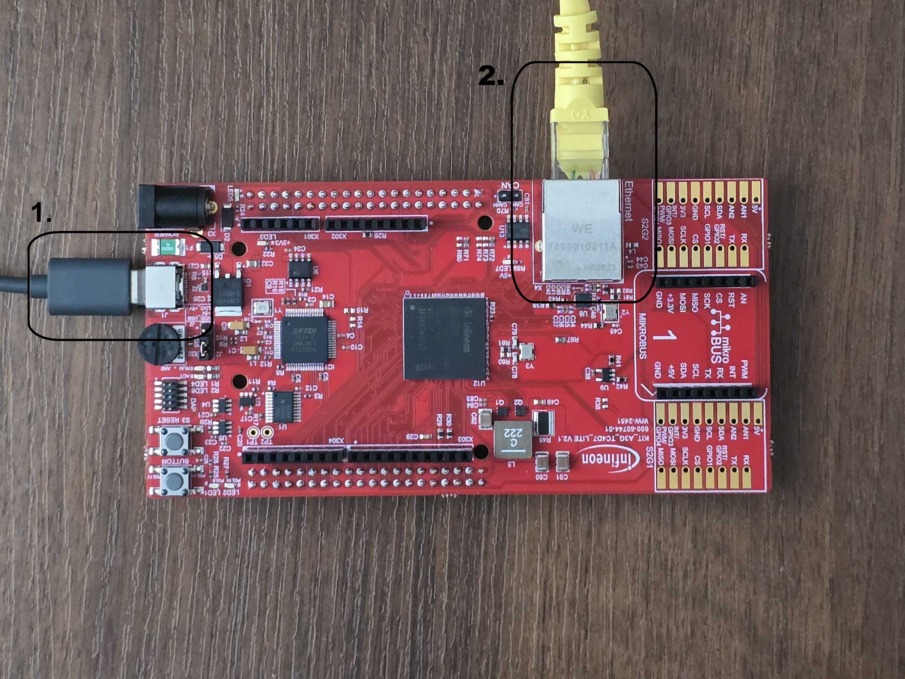
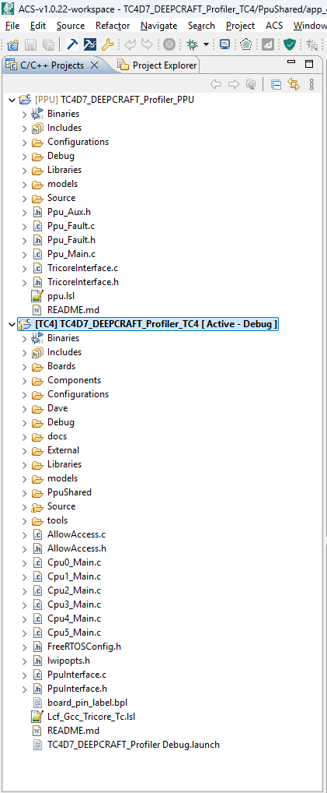
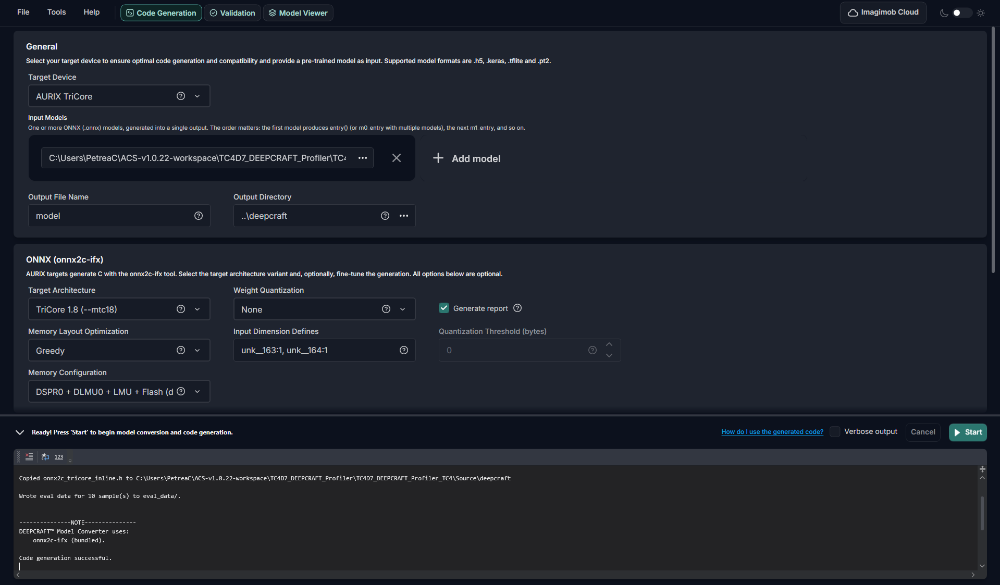
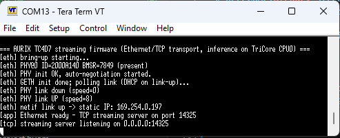
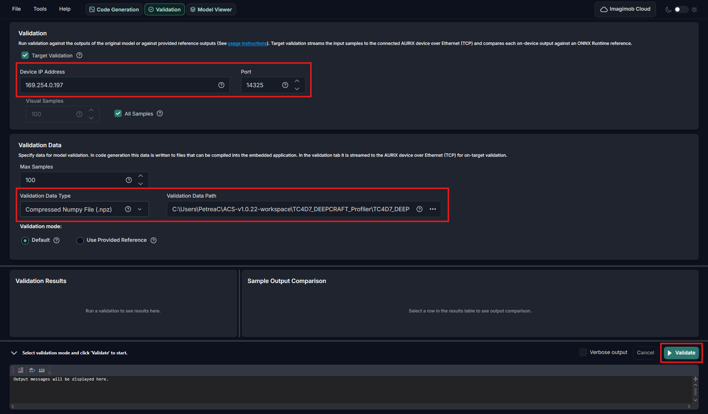
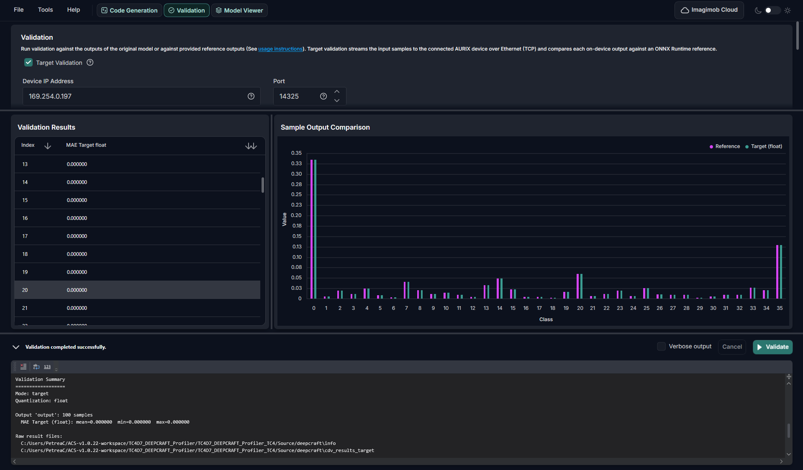
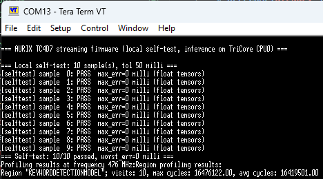

# iLLD_TC4D7_ACS_DEEPCRAFT_ML_PROFILER_TC4

**Example project for deploying and validating ML models on the Aurix TC4D7 Lite Kit**

## Device

The device used in this code example is the AURIX&trade; TC4D7Xx_A-Step.

## Board

The board used for testing is the AURIX&trade; TC4D7 Lite Kit
(KIT_A3G_TC4D7_LITE).

## Scope of work

Example project for deploying, profiling and validating ONNX ML models on TriCore&trade; or PPU (with acceleration) using the Deepcraft Model Converter (with onnx2c-ifx) tool

## Introduction

This code example makes the TC4D7 a deployment target for the DEEPCRAFT&trade;
Model Converter tool chain. A neural network exported from ONNX to C is compiled
into the firmware, executed on the device, and its behaviour is made observable
in three ways:

- streaming — the device exchanges input and output tensors with a host tool over
  Ethernet or over the serial interface, so that on-device results can be
  compared against an ONNX reference
- local self-test — the device runs a set of exported validation samples with no
  host attached and reports the result on the serial console
- profiling — the model is timed on-chip, and the cycle counts are
  reported together with the clock frequency they were measured at

Where the network runs is a compile-time choice: on TriCore&trade; CPU0, or
offloaded to the PPU. Both paths use the same generic model API, so a different
model can be dropped in without changing firmware code. Because the two cores
need two different toolchains, the code example consists of two subprojects, one
per core.

- **PPU** — the Parallel Processing Unit is the machine-learning accelerator
  subsystem of the AURIX&trade; TC4x, built around an ARC EV vector processor
  that runs its own image out of its own program flash partition and uses three
  data memories: VCCM (the vector core's closely coupled memory), CSM (the
  PPU-local RAM) and a window into the LMU
- **ASCLIN** — the Asynchronous/Synchronous Interface module; ASCLIN0 is operated
  in ASC (UART) mode and carries either the *printf* debug console or, in the
  UART build variant, the binary streaming protocol
- **GETH** — the Gigabit Ethernet module provides the MAC, its own DMA and the
  MDIO master; it is operated here in RMII mode against the on-board DP83825I PHY
  at 100 Mbit/s full duplex
- **STM** — the System Timer is a free-running counter used as the tick source
  for the profiling measurements taken on the TriCore&trade;
- **SRC** — the Service Request Controller routes the interrupts of this code
  example, including the service requests used to signal between TriCore&trade;
  CPU0 and the PPU
- **LMU** — the Local Memory Unit is on-chip RAM reachable by both cores; it
  holds the shared TriCore&trade;-to-PPU mailbox and, by default, the model
  tensors of the TriCore&trade; inference path
- **DSPR** — the Data Scratch-Pad RAM is CPU0's private 240 KB RAM, holding the
  stack, heap, CSA and the network buffer pools, and optionally the model tensors
- **PFLASH** — the Program Flash holds both images, in two separate partitions,
  plus the load images of all initialised data sections
- **WTU** — the Watchdog Timer Unit supervises the startup phase; its reload
  value matters here because copying model weights from PFLASH to RAM happens
  inside the startup window

## Hardware setup



*Only two connectors are used. 1. USB-C, on-board debugger: always connect to
the host PC — it powers the board, provides the DAS link used for
programming, and carries the ASCLIN0 virtual COM port. 2. Ethernet: connect
directly to the host PC when using the default static IP, or to a network
switch/router when using DHCP.*

The code example uses on-board peripherals only — no external components, wiring
or jumper changes are required:

- connect the USB cable between the host and the on-board debugger connector; it
  powers the board, provides the DAS link used for programming, and enumerates as
  the virtual COM port that carries ASCLIN0
- connect an Ethernet cable between the board and the host, directly or through a
  switch, when the Ethernet transport is used
- for the local self-test and for the UART transport, the USB cable alone is
  sufficient

## Implementation

### Project structure

The TriCore&trade; and the PPU are two separate subprojects with two separate
toolchains:

| Subproject | Core | Toolchain | Artifact |
| --- | --- | --- | --- |
| *illd_tc4d7_acs_deepcraft_ml_profiler_TC4* (this one) | TriCore&trade; CPU0 | TriCore&trade; GCC (*tricore-elf-gcc-11*) | *Debug/illd_tc4d7_acs_deepcraft_ml_profiler_TC4.hex* |
| *illd_tc4d7_acs_deepcraft_ml_profiler_PPU* | PPU (ARC EV) | ARC-LLVM clang 21 | *Debug/illd_tc4d7_acs_deepcraft_ml_profiler_PPU.elf* |

This README covers the code example as a whole and the TriCore&trade;
subproject, which owns the boot sequence, the streaming protocol, both
transports, the self-test harness, the shared configuration in *PpuShared/* and
the *tools/* scripts that build and flash both images. Everything specific to the
PPU image is described in the PPU README.

Only the files unique to this code example are listed below; the rest is stock
Infineon ACS scaffolding (iLLD drivers, board/config, DAVE).

```text
illd_tc4d7_acs_deepcraft_ml_profiler_TC4/
├── README.md                       This file
├── Cpu0_Main.c                     CPU0 boot: DAVE_Init, start PPU, scheduler + app task
├── Cpu1..5_Main.c                  Idle secondary TriCore&trade; cores
├── Lcf_Gcc_Tricore_Tc.lsl          TriCore&trade; linker script (incl. reserved PPU regions)
├── PpuInterface.{c,h}              Start the PPU, publish the shared IPC pointer
├── AllowAccess.{c,h}               Grant the PPU bus/memory access
├── FreeRTOSConfig.h, lwipopts.h
├── models/                         Reference ONNX models + validation .npz
│
├── tools/
│   ├── build_flash.ps1             Build and/or flash BOTH subprojects from the CLI
│   ├── capture_console.ps1         Reset the board and capture the ASCLIN0 console
│   └── streaming_probe.py          Host-side streaming client (UART/TCP)
│
├── PpuShared/                     *** Cross-core contract — ONE copy, both cores compile it ***
│   ├── app_config.h               *** All user configuration (mode/transport/infer + tunables) ***
│   ├── ppu_ipc.h                   Shared TriCore&trade;<->PPU mailbox struct + layout helpers
│   └── SharedData/SharedData.h     Shared-memory layout / PPU copy table
│
├── Configurations/                 Per-core iLLD config (Ifx_Cfg*.h)
├── Dave/                           DAVE APP configuration (currently unused — see below)
├── Boards/, Components/serialio/
├── External/                       FreeRTOS, lwIP, PHY, PDL, ports
└── Source/
    ├── local_selftest.{c,h}        Host-less self-test harness
    ├── local_selftest_data.h       Binds the harness to the Model Converter's exported eval_data/
    ├── deepcraft/                  Generated plain-C (onnx2c-ifx) model — TriCore&trade; inference
    │   ├── onnx2c_config.h         Hand-maintained tensor placement (DSPR0 / LMU / flash)
    │   └── eval_data/              Model Converter-exported self-test vectors (model_data_*.h)
    ├── streaming/                  Protocol device plumbing (dev_model, dev_log, uart_stream, protocol/)
    ├── net/                        eth.{c,h} (GETH/DP83825I + lwIP), tcp_stream.{c,h}
    └── ppu/ppu_dispatch.{c,h}      CPU0 side of the PPU mailbox
```

Each subproject has exactly one *Source/deepcraft/* folder; the model inside
differs (plain C on the TriCore&trade;, ARC-vector on the PPU).

*PpuShared/* is compiled by **both** subprojects — the PPU project reaches it
through the include path *../../illd_tc4d7_acs_deepcraft_ml_profiler_TC4/PpuShared*. Keep
exactly one copy; two divergent copies produce two images that silently disagree
about the mailbox layout.


*Both subprojects in the ACS Project Explorer: PpuShared/ under the
TriCore&trade; project, Source/deepcraft/ under each.*

### Build variant selection (*app_config.h*)

Nothing is selected at run time. Three independent macros in
[*PpuShared/app_config.h*](PpuShared/app_config.h) decide what is compiled. All
of them are guarded with *#ifndef*, so they can also be overridden with *-D* on
the compiler command line.

| Macro | Values | As shipped | Meaning |
| --- | --- | --- | --- |
| *APP_MODE* | *APP_MODE_STREAM* / *APP_MODE_LOCAL* | *APP_MODE_STREAM* | Stream tensors with a host, or run the built-in samples as a host-less self-test |
| *APP_TRANSPORT* | *APP_TRANSPORT_ETH* / *APP_TRANSPORT_UART* | *APP_TRANSPORT_ETH* | Which link carries the protocol (stream mode only) |
| *APP_INFER* | *APP_INFER_TRICORE* / *APP_INFER_PPU* | *APP_INFER_PPU* | Run the model on CPU0, or offload it to the PPU |

*APP_INFER* is orthogonal to the other two: the streaming protocol and the
self-test harness always run on CPU0, and only the call to *IMAI_compute()* is
dispatched. The combinations of *APP_MODE* and *APP_TRANSPORT* are:

- **Ethernet streaming** (*APP_MODE_STREAM* + *APP_TRANSPORT_ETH*) — the
  protocol runs over TCP port 14325 on FreeRTOS and lwIP, and *printf* output
  goes to the ASCLIN0 console at 115200 baud
- **UART streaming** (*APP_MODE_STREAM* + *APP_TRANSPORT_UART*) — the protocol
  runs as a binary stream on ASCLIN0 at 3 Mbaud, so *printf* output is redirected
  into the protocol's *Debug Log* device instead; this variant is currently not
  functional in this port, see the note in *app_config.h*
- **Local self-test** (*APP_MODE_LOCAL*) — no host and no transport; the
  built-in samples are run through the model and the result is printed on the
  ASCLIN0 console at 115200 baud

*APP_INFER* selects where the inference runs:

- *APP_INFER_TRICORE* — *IMAI_compute()* runs on CPU0 from
  [*Source/deepcraft/*](Source/deepcraft), a plain-C onnx2c-ifx export; only the TriCore&trade; image is needed and the PPU
  stays idle
- *APP_INFER_PPU* — the inference is offloaded to the PPU, which runs its own
  ARC-vector export (*--arcppu256* / *--arcppu128*), and CPU0 exchanges the
  tensors over a shared-memory mailbox; this variant needs both images, see the
  PPU README.

Both inference paths support any number of input and output tensors, not just one
of each. The streaming protocol registers one stream per tensor, the self-test
allocates one buffer per tensor from the model metadata, and the
TriCore&trade;-to-PPU mailbox concatenates all inputs and then all outputs in the
model's own metadata order — see the *TcPpuIpcData* comment in
[*ppu_ipc.h*](PpuShared/ppu_ipc.h) for the exact layout.

> Rebuild and flash both images together whenever the shared IPC layout changes,
> that is after editing *ppu_ipc.h*, *APP_MODEL_MAX_INPUT_BYTES*,
> *APP_MODEL_MAX_OUTPUT_BYTES*, *APP_MODEL_MAX_TENSORS* or
> *APP_PPU_MAX_REGIONS*. A layout mismatch does not fail the build; it shows up
> as garbage data at run time.

### Boot sequence

*core0_main()* in [*Cpu0_Main.c*](Cpu0_Main.c) is the entry point:

1. *IfxCpu_enableInterrupts()* enables the interrupt system
2. *IfxWtu_disableCpuWatchdog()* and *IfxWtu_disableSystemWatchdog()* switch the
   watchdogs off for the rest of the run
3. *DAVE_Init()* is called before the hand-written peripheral bring-up, so that
   any APP added later is initialised at the right point
4. *SERIALIO_Init()* brings up the ASCLIN0 *printf* console, except in the
   UART-transport build, where ASCLIN0 carries the protocol instead
5. for *APP_INFER_PPU*, *allowAccess()* grants the bus masters access and
   *ppu_interface_start_ppu()* releases the PPU from reset and blocks until it
   signals that it has booted
6. *xTaskCreate()* creates the single application task and
   *vTaskStartScheduler()* starts FreeRTOS

*app_task()* then branches on *APP_MODE*: it calls *local_selftest_run()* once
for *APP_MODE_LOCAL*, or creates the protocol object and serves it over the
selected transport for *APP_MODE_STREAM*.

*Cpu1_Main.c* to *Cpu5_Main.c* only disable their own watchdog and spin — this
code example uses CPU0 and the PPU only.

### ASCLIN0 console and UART transport

*SERIALIO_Init()* in *Components/serialio* configures ASCLIN0 in ASC mode through
*IfxAsclin_Asc_initModuleConfig()* and *IfxAsclin_Asc_initModule()*, on the
*BOARD_DEBUG_UART_TX* / *BOARD_DEBUG_UART_RX* pins and at
*APP_DEBUG_UART_BAUDRATE*. It is operated in polling mode, and *printf* is
retargeted onto it.

In the UART-transport build the same module is owned by
[*Source/streaming/uart_stream.c*](Source/streaming/uart_stream.c) instead.
*uart_stream_init()* configures ASCLIN0 at *APP_STREAM_UART_BAUDRATE* with
interrupt-driven software FIFOs of 24 KB for receive and 4 KB for transmit,
because the protocol frames are far larger than the hardware FIFO. The three
service request handlers are declared with *IFX_INTERRUPT* and get the
priorities *UART_STREAM_TX_PRIO* (10), *UART_STREAM_RX_PRIO* (11) and
*UART_STREAM_ER_PRIO* (12); the same numbers are written into
*ascConfig.interrupt.txPriority*, *rxPriority* and *erPriority*, and they also
decide the vector table slot each handler is placed in. The two owners of ASCLIN0
are mutually exclusive, which is why the transport is a compile-time choice.

### Ethernet transport

[*Source/net/eth.c*](Source/net/eth.c) brings up GETH0 port 0 and the on-board
DP83825I PHY:

- *IfxPmsEvr_enableVoltageRail()* and *IfxGeth_enableModule()* power and enable
  the module, and *IfxVmt_clearSram()* initialises its SRAM
- *IfxHsphy_Geth_setupRmiiInputPins()* and *IfxHsphy_Geth_setupRmiiOutputPins()*
  select the RMII pin set of the board
- *IfxGeth_Eth_initModuleConfig()* fills the configuration structure, after which
  *config.dma.txChannel[0].txBuffer1Size* and
  *config.dma.rxChannel[0].rxBuffer1Size* are set to *ETH_TX_BUFFER_SIZE* and
  *ETH_RX_BUFFER_SIZE* (1528 bytes, one full Ethernet frame plus tag and
  alignment), and *config.dma.rxInterrupt[IfxGeth_DmaChannel_0].priority* and its
  transmit counterpart are set to *ETH_GETH0_DMA_PRIO*
- *IfxGeth_Mdio_init()* opens the MDIO channel to the PHY at address
  *BOARD_GETH0_P0_PHYADR*, which is then configured for 100 Mbit/s full duplex
- *IfxGeth_startRxDma()* and *IfxGeth_startTxDma()* start the descriptor rings

*ETH_GETH0_DMA_PRIO* is 20. It has to stay at or below
*configMAX_API_CALL_INTERRUPT_PRIORITY*, because the GETH DMA handler calls
FreeRTOS API functions from interrupt context and an interrupt above that
priority is not masked by the FreeRTOS critical sections; it also has to differ
from the FreeRTOS tick and context-switch priorities.

The MAC address is the fixed array *g_mac_address*. *eth_start()* attaches the
lwIP *netif*, starts the receive task, and then either applies the static address
from *APP_ETH_IP_ADDR*, *APP_ETH_NETMASK* and *APP_ETH_GATEWAY* or starts the
DHCP client, depending on *APP_ETH_STATIC_IP*. *eth_is_ready()* reports when the
interface has an address; *eth_link_is_up()* and *eth_debug_status()* expose the
PHY state.

[*Source/net/tcp_stream.c*](Source/net/tcp_stream.c) then serves the protocol.
*tcp_stream_serve()* listens on *APP_STREAM_TCP_PORT* with a backlog of
*TCP_STREAM_BACKLOG* (1, so one client at a time) and a receive timeout of
*TCP_STREAM_RECV_TIMEOUT_MS* (10 ms) that serves only as a polling tick, and
binds the socket to the protocol through the *_tcp_read()* and *_tcp_write()*
nanopb stream callbacks.

### Streaming protocol devices

[*Source/streaming/*](Source/streaming) holds the transport-independent part.
*protocol_create()* builds the device object advertised to the host — board name,
the 16-byte *STREAM_SERIAL_UUID* and the firmware version — and two devices are
registered on it:

- *dev_log_register()* in [*dev_log.c*](Source/streaming/dev_log.c) adds the
  *Debug Log* device and retargets the newlib *write()* into a ring buffer, so
  that *printf* output still reaches the host when ASCLIN0 is carrying the
  protocol
- *dev_model_register()* in [*dev_model.c*](Source/streaming/dev_model.c) adds
  one stream per model tensor, taking the tensor count, the byte size and the
  element type from the model metadata, and installs the STM-based tick source
  used by the profiling counters

For *APP_INFER_PPU*, *dev_model_register()* additionally validates the metadata
the PPU publishes against the mailbox capacity and refuses to register with
*PROTOCOL_STATUS_VALUE_OUT_OF_RANGE* if the model does not fit, instead of
overrunning the shared buffers at run time.

*Source/streaming/protocol/* is an unmodified copy of the tensor streaming
protocol implementation — see the README in that folder before changing anything
there.

### Local self-test harness

*local_selftest_run()* in [*Source/local_selftest.c*](Source/local_selftest.c)
allocates one buffer per tensor from the model metadata, feeds every exported
sample through the same inference call the streaming path uses, and compares the
result against the exported expected output. Floating-point tensors are compared
with *APP_SELFTEST_TOLERANCE* as the maximum absolute error, integer tensors are
compared exactly. The function returns the number of failed samples and prints a
per-sample PASS/FAIL line, a summary and the profiling table.

The test vectors are not hand-written. Running the DEEPCRAFT&trade; Model
Converter with validation data enabled exports
*Source/deepcraft/eval_data/model_data_input.h* and *model_data_output.h*
alongside the model itself, so the sample count, the tensor sizes and the
expected values all come from the validation *.npz*.
[*Source/local_selftest_data.h*](Source/local_selftest_data.h) binds the harness
to those generated headers; *APP_SELFTEST_TOLERANCE* is the only manual setting
left. The harness checks the vector sizes against what the model reports and
fails with an explicit message instead of silently comparing against the wrong
model.

### Inference dispatch to the PPU

For *APP_INFER_PPU* the model call is replaced by
[*Source/ppu/ppu_dispatch.c*](Source/ppu/ppu_dispatch.c), the single place where
CPU0 drives the mailbox:

- *ppu_dispatch_wait_meta_ready()* spins, bounded, on the *ready* flag that the
  PPU sets last when it publishes its model metadata; waiting for the boot
  service request alone is not sufficient, because that interrupt can overtake
  the PPU's still-buffered writes into the shared LMU region
- *ppu_dispatch_run()* copies the input tensors into the mailbox, raises the
  request, waits for the *done* flag for at most
  *APP_PPU_DISPATCH_TIMEOUT_TICKS* STM ticks, and copies the outputs back

Every tensor in the mailbox starts on a *PPU_TENSOR_ALIGN* (4-byte) boundary.
*PpuMeta_inputOffsetBytes()* and *PpuMeta_outputOffsetBytes()* in
[*ppu_ipc.h*](PpuShared/ppu_ipc.h) are the only definition of that layout and are
used by both cores, so the two images cannot drift apart. The alignment is what
lets a model mix *int8*, *int16*, *int32* and *float32* tensors without an
unaligned access fault on the ARC side.

On a timeout *ppu_dispatch_run()* returns *false* and decodes the fault record
that the PPU publishes into the same shared structure, so that a PPU exception is
reported on the console instead of appearing as a silent hang. The signalling
itself uses two service requests, set up in [*PpuInterface.c*](PpuInterface.c):
*MODULE_SRC.PPU.ICI* towards the PPU and *MODULE_SRC.GPSR[0].SR0* back towards
CPU0.

### Profiling

Both model exports are compiled with *IMAI_PROFILING*, which times every model
region. On the TriCore&trade; the tick source is the free-running STM counter; on
the PPU it is ARC Timer0, whose counts are published to CPU0 through the shared
IPC together with the frequency they were measured at. CPU0 prints one line per
region with the visit count and the maximum and average cycle count, either on
the ASCLIN0 console (*APP_MODE_LOCAL*) or over the *Debug Log* device
(*APP_MODE_STREAM*). Building once with *APP_INFER_TRICORE* and once with
*APP_INFER_PPU* gives a direct comparison of the two cores on the same model; the
PPU numbers are pure model compute, without the CPU0 dispatch and transport
overhead.

If the PPU reports no regions at all, its image was built without
*IMAI_PROFILING* — see ppu-preprocessor-defines-important, in the PPU README.

### Tunable parameters (*app_config.h*)

The remaining settings in [*PpuShared/app_config.h*](PpuShared/app_config.h):

| Macro | Default | Purpose |
| --- | --- | --- |
| *APP_ETH_STATIC_IP* | 1 | Fixed IP address (1) or DHCP (0), Ethernet transport only |
| *APP_ETH_IP_ADDR* / *APP_ETH_NETMASK* / *APP_ETH_GATEWAY* | 169.254.0.197 / 255.255.255.0 / 169.254.0.1 | Static address strings |
| *APP_DEBUG_UART_BAUDRATE* | 115200 | ASCLIN0 *printf* console baud rate |
| *APP_STREAM_UART_BAUDRATE* | 3000000 | ASCLIN0 binary protocol baud rate, UART transport |
| *APP_STREAM_TCP_PORT* | 14325 | Protocol TCP port, Ethernet transport |
| *APP_SELFTEST_TOLERANCE* | 0.05 | Maximum absolute error for a self-test PASS on a floating-point tensor |
| *APP_MODEL_MAX_INPUT_BYTES* / *APP_MODEL_MAX_OUTPUT_BYTES* | 8000 / 256 | Upper bounds in bytes on the model I/O, totalled across all input tensors and across all output tensors. Bytes rather than elements, because a model may mix element types and every tensor starts on a 4-byte boundary in the mailbox. They size the self-test buffers, the shared IPC buffers and the PPU VCCM staging buffers; the actual per-model sizes come from the metadata at run time |
| *APP_MODEL_MAX_TENSORS* | 8 | Upper bound on the number of input tensors and of output tensors |
| *APP_PPU_MAX_REGIONS* | 8 | Upper bound on the profiling regions reported by the PPU |
| *APP_PPU_DISPATCH_TIMEOUT_TICKS* | 5000000000 | Maximum number of STM ticks CPU0 waits for one PPU inference |

> *APP_MODEL_MAX_INPUT_BYTES*, *APP_MODEL_MAX_OUTPUT_BYTES*,
> *APP_MODEL_MAX_TENSORS* and *APP_PPU_MAX_REGIONS* size the shared IPC
> structure, so changing any of them requires rebuilding and flashing both
> images. They are capacities, not the actual per-model sizes.
>
> Keep *APP_PPU_DISPATCH_TIMEOUT_TICKS* well inside the host's per-sample budget
> — the on-target validation client gives up after 15 s per sample.

### TriCore&trade; model memory placement (*onnx2c_config.h*)

The generated tensors of the plain-C model can be placed in either of CPU0's two
RAM regions, or left in flash:

- **DSPR0** — CPU0's private scratchpad, 240 KB, which also holds the stack, heap
  and CSA and, in the Ethernet build, the lwIP and FreeRTOS pools, so it is easy
  to overflow
- **LMU** — 512 KB and otherwise unused in this code example, which is why it is
  the default
- **Flash** — read-only weights stay in program flash and are read in place; no
  RAM cost, but slower on repeated access

The placement is controlled by
[*Source/deepcraft/onnx2c_config.h*](Source/deepcraft/onnx2c_config.h), a
hand-maintained header that is not regenerated by onnx2c-ifx and therefore
survives a re-export. *model_onnx2c.c* includes it when the translation unit is
built with *-DONNX2C_CONFIG*, which is already in the project's defined symbols.
Edit *ONNX2C_RW_PLACEMENT* and *ONNX2C_RO_PLACEMENT* to change the defaults:

| Macro | Valid values | Default |
| --- | --- | --- |
| *ONNX2C_RW_PLACEMENT* (the onnx2c *tuN* scratch buffers) | *ONNX2C_MEM_LMU*, *ONNX2C_MEM_DSPR0* | *ONNX2C_MEM_LMU* |
| *ONNX2C_RO_PLACEMENT* (weights and constants) | *ONNX2C_MEM_LMU*, *ONNX2C_MEM_DSPR0*, *ONNX2C_MEM_FLASH* | *ONNX2C_MEM_LMU* |

*ONNX2C_MEM_FLASH* is not valid for the read/write scratch buffers, because they
are written at run time.

#### Startup watchdog window and large weight copies

A model with its weights placed in DSPR0 or LMU is copied from flash into RAM by
the C runtime's *__copy_table*, which runs inside Infineon's startup software
(*Ifx_Ssw_Tc0.c*, *__StartUpSoftware_Phase3*) — before *core0_main()*, and
therefore before the console exists and before the code example can call
*IfxWtu_disableCpuWatchdog()* and *IfxWtu_disableSystemWatchdog()*. The same
phase also runs *hardware_init_hook()*, which clears every LMU bank in hardware.
Together, a weight copy of a few hundred KB can exceed the default startup reload
value of the CPU and system watchdogs (*IFX_CFG_SSW_WDG_RELOAD_VALUE*, in the
order of 10 ms to 20 ms), so the WTU fires in the middle of the copy and resets
the core in a silent loop: no boot banner and no diagnostic, indistinguishable
from a genuine hang.

[*Configurations/Ifx_Cfg.h*](Configurations/Ifx_Cfg.h) therefore widens the
window to roughly 670 ms, before the default from *Ifx_Ssw_Infra.h* takes effect:

```c
#define IFX_CFG_SSW_WDG_RELOAD_VALUE (0xF000u)
```

This affects the one-time startup phase only — the code example still disables
both watchdogs permanently in *core0_main()* — so the WTU keeps protecting
against genuine startup hangs while leaving large copies room to finish.

### PPU memory

The PPU has a budget of its own: 128 KB of VCCM shared between the model's
*__vccm* tensors, the IPC staging buffers and both stacks, plus its own placement
header. See PPU memory in the PPU README.

### Using your own model

1. Generate the model with the DEEPCRAFT&trade; Model Converter (onnx2c-ifx) for
   the TriCore&trade; target, into
   [*Source/deepcraft/*](Source/deepcraft); it is consumed through the generic
   *IMAI_\** API and its metadata, so no I/O size or shape is hard-coded in the
   firmware, and the matching inline header *onnx2c_tricore_inline.h* is copied
   into the output folder automatically
2. Check the buffer bounds — if the total I/O of the model exceeds
   *APP_MODEL_MAX_INPUT_BYTES* or *APP_MODEL_MAX_OUTPUT_BYTES*, raise them, and
   rebuild both images for *APP_INFER_PPU*
3. Add validation data in the converter project so that *eval_data/* is
   exported, which is only needed for *APP_MODE_LOCAL*; the *models/* folder
   holds ready-made ONNX models and *.npz* validation sets
4. Keep the *outputPath* entry of *project.byom* in step with the folder name; it
   reads *..\\deepcraft*, and if the two disagree a re-export writes the
   artifacts into the wrong folder, which then either fails to build or silently
   keeps using the old artifacts
5. Rebuild and flash, both images for *APP_INFER_PPU*


*Code Generation for the TriCore&trade; target: `AURIX&trade; TriCore&trade;` / `TriCore&trade; 1.8 (--mtc18)`, output directory `..\deepcraft`. Compare with the PPU target selection in the PPU README.

> Always clean before rebuilding after a model swap. An incremental build does
> not reliably recompile every file that reads the tensor counts from *model.h*,
> so a stale object can keep the previous model's counts while the new,
> differently sized generated data is linked in — which reads past the end of the
> smaller table instead of failing cleanly. `.\tools\build_flash.ps1 -Action clean`
> first is cheap insurance whenever a model with a different tensor count is
> swapped in.

> A re-export overwrites *Source/deepcraft/model.c* and drops the `#include
> <stdio.h>` that this port added by hand; without it,
> *IMAI_print_region_profiling()*'s calls to *printf()* only trigger an
> implicit-declaration compiler warning, not a build failure, so this is easy to
> miss. Re-add the include after every re-export until a future DEEPCRAFT&trade;
> Model Converter release emits it directly.

> The self-test vectors always live in the TriCore&trade; project, because CPU0
> drives the self-test for both inference targets. For *APP_INFER_TRICORE* this
> is automatic. For *APP_INFER_PPU*, run the converter on the PPU project as well
> — same model, same validation data — and copy its
> *Source/deepcraft/eval_data/* headers over the TriCore&trade; project's copy,
> so that the expected outputs match the model the PPU actually runs.

The only dependency of the inference itself is the *Source/deepcraft/* folder and
the *IMAI_\** API; none of the streaming or self-test scaffolding is required to
run a model. The cleanest wiring reference is *local_selftest_run()* in
[*Source/local_selftest.c*](Source/local_selftest.c), with
[*Source/streaming/dev_model.c*](Source/streaming/dev_model.c) doing the same
around the protocol.

**APP(s) Used**

No DAVE APP is used. *Dave/Model/APPS/* is empty and the generated *DAVE_Init()*
is an empty weak stub; [*Cpu0_Main.c*](Cpu0_Main.c) still calls it, so that an
APP added later through the DAVE GUI is initialised at the right point in the
boot sequence. ASCLIN0, GETH0 with the DP83825I PHY, and the board pins are
brought up by hand in *Components/serialio*,
[*Source/net/eth.c*](Source/net/eth.c) and *Boards/*.

There are two reasons for this: DAVE has no GETH APP, so the Ethernet bring-up
had to be hand-written in any case, and ASCLIN0 has two mutually exclusive owners
selected by *APP_TRANSPORT* — a polled 115200 baud console against an
interrupt-driven 3 Mbaud protocol link with 24 KB and 4 KB FIFOs — which a single
APP cannot express. *PRINTF_ASCLIN* in particular would also collide with the
newlib *write()* retarget in
[*Source/streaming/dev_log.c*](Source/streaming/dev_log.c). DAVE remains
available for genuinely new peripherals, where there is no existing bring-up to
conflict with.

### Pin assignment

The pin macros are defined in *Boards/KIT_TC4D7_LITE/pin.h*.

| Signal | Macro | Pin |
| --- | --- | --- |
| ASCLIN0 transmit | *BOARD_DEBUG_UART_TX* | P14.0 |
| ASCLIN0 receive | *BOARD_DEBUG_UART_RX* | P14.1 |
| GETH0 port 0 RMII receive data 0 | *BOARD_GETH0_P0_RXD0* | P16.4 |
| GETH0 port 0 RMII receive data 1 | *BOARD_GETH0_P0_RXD1* | P16.0 |
| GETH0 port 0 RMII carrier sense / receive data valid | *BOARD_GETH0_P0_CSRDV* | P16.1 |
| GETH0 port 0 RMII reference clock | *BOARD_GETH0_P0_REFCLK* | P16.2 |
| GETH0 port 0 RMII transmit data 0 | *BOARD_GETH0_P0_TXD0* | P16.6 |
| GETH0 port 0 RMII transmit data 1 | *BOARD_GETH0_P0_TXD1* | P16.8 |
| GETH0 port 0 RMII transmit enable | *BOARD_GETH0_P0_TXEN* | P16.13 |
| MDIO clock | *BOARD_GETH0_P0_MDC* | P21.2 |
| MDIO data | *BOARD_GETH0_P0_MDIO* | P21.3 |

The PHY address on the MDIO bus is *BOARD_GETH0_P0_PHYADR* (0). ASCLIN0 carries
the *printf* console in the Ethernet and self-test variants, and the binary
protocol in the UART variant — the same two pins in both cases.

### Interrupt and DMA configuration

All service requests of this code example are handled by CPU0.

| Service request | Priority | Configured in |
| --- | --- | --- |
| GETH0 DMA channel 0, receive and transmit | *ETH_GETH0_DMA_PRIO* (20) | [*Source/net/eth.c*](Source/net/eth.c) |
| ASCLIN0 transmit, UART transport only | *UART_STREAM_TX_PRIO* (10) | [*Source/streaming/uart_stream.c*](Source/streaming/uart_stream.c) |
| ASCLIN0 receive, UART transport only | *UART_STREAM_RX_PRIO* (11) | [*Source/streaming/uart_stream.c*](Source/streaming/uart_stream.c) |
| ASCLIN0 error, UART transport only | *UART_STREAM_ER_PRIO* (12) | [*Source/streaming/uart_stream.c*](Source/streaming/uart_stream.c) |
| PPU inter-core interrupt, *MODULE_SRC.PPU.ICI*, type of service *IfxSrc_Tos_ppu* | 0 | [*PpuInterface.c*](PpuInterface.c) |

The GETH0 DMA priority must stay at or below
*configMAX_API_CALL_INTERRUPT_PRIORITY* and must differ from the FreeRTOS tick
and context-switch priorities. The three ASCLIN0 priorities double as vector
table slots, because *IFX_INTERRUPT* places each handler at
*__INTTAB_CPU0* + priority x 0x20.

The PPU signals back to CPU0 through *MODULE_SRC.GPSR[0].SR0*, which is used as a
flag polled by *ppu_interface_is_ppu_booted_up()* rather than as an interrupt source.

### Hardware resource assignment

No resource manager assignment is used. For *APP_INFER_PPU*:

- *allowAccess()* in [*AllowAccess.c*](AllowAccess.c) grants the bus masters
  access to the LMU and to the PPU controller
- *ppu_interface_start_ppu()* in [*PpuInterface.c*](PpuInterface.c) enables the PPU
  with *IfxPpucCore_enableModule()*, clears and ECC-initialises the PPU CSM and
  VCCM ranges delimited by the *__PPU_CSM_START* / *__PPU_CSM_END* and
  *__PPU_VCCM_START* / *__PPU_VCCM_END* linker symbols, copies the PPU vector
  table to the start of CSM (the reset vector address of the PPU), initialises
  *MODULE_SRC.PPU.ICI* and starts the core with *IfxPpucCore_startCore()*
- the TriCore&trade; linker script *Lcf_Gcc_Tricore_Tc.lsl* reserves the flash and
  LMU ranges the PPU image occupies, so that the two images cannot overlap

## Compiling and programming

Open the workspace in AURIX&trade; Configuration Studio and build the subprojects
that are needed — *illd_tc4d7_acs_deepcraft_ml_profiler_TC4*, plus
*illd_tc4d7_acs_deepcraft_ml_profiler_PPU* for *APP_INFER_PPU* — then flash the images and
reset the board.

To build or flash from a shell instead, use the bundled helper, which drives both
toolchains:

```powershell
.\tools\build_flash.ps1                  # build both, then flash both, then reset
.\tools\build_flash.ps1 -Action build    # build only
.\tools\build_flash.ps1 -Action flash    # flash the existing images
.\tools\build_flash.ps1 -Action clean    # clean both build outputs
.\tools\build_flash.ps1 -Target tricore  # TriCore&trade; only (APP_INFER_TRICORE)
.\tools\build_flash.ps1 -Action flash -WhatIf   # dry run
```

Both images build from the command line, because ARC-LLVM clang has no IDE-only
step. The script uses the AURIX&trade; Flasher bundled with ACS, so nothing extra
has to be installed; DAS has to be running, which it normally is. Each image is
programmed with `-erase on -prog on -start off`: `-erase on` only erases the
sectors that image occupies, and the two images live in separate flash regions,
so they do not erase each other. The board is then restarted with an explicit DCO
reset, because the flasher's own `-start on` can leave a TC4x core halted. The
script warns when the two images were built far apart in time, since a shared IPC
change flashed on one core only shows up as garbage data rather than as an error.

> After adding or removing source files, or changing *.cproject* (include paths,
> defined symbols, exclusions), refresh with **F5** and rebuild in ACS so that it
> regenerates the managed makefiles and the *-I* response files under *Debug/*.
> Anything hand-edited under *Debug/* is build output and will be lost.

> A clean TriCore&trade; build reports two categories of pre-existing warnings
> that are not part of this code example and need no fix: about 300
> *'always_inline' function might not be inlinable* notes from the iLLD headers,
> and one *'pxCsa' is used uninitialized* from the bundled FreeRTOS GCC port
> (*External/ports/FreeRTOS/GCC/port.c*). Both come from vendored/third-party
> code, not from the code example's own sources.

## Run and Test

Flash the images, reset the board, and follow the section matching the build
variant.

### Ethernet streaming

The board uses a fixed IP address by default (*APP_ETH_STATIC_IP* is 1,
*APP_ETH_IP_ADDR* is 169.254.0.197); set *APP_ETH_STATIC_IP* to 0 to use DHCP
instead. Either way, the address in use is printed on the ASCLIN0 console at
115200 baud, 8N1, after reset.


*The boot banner on ASCLIN0 at 115200 baud: PHY link-up, the IP address in use, and the streaming server listening on port 14325.*

Then open the *Validate on Target* view of the DEEPCRAFT&trade; Model Converter,
enter the IP address of the board and port 14325 (*APP_STREAM_TCP_PORT*), select
the validation data, and start the run. The tool streams the input samples to the
board and compares the returned output against the ONNX reference.


*Validate on Target before a run: device IP address and port, and the validation data type and path fields.*


*Validate on Target after a run: the per-sample mean absolute error table and the reference-against-target output chart.*

The code example is working correctly when:

- the console reports the PHY link coming up and prints the address in use
- the client connects and the run completes without the session being interrupted
- the per-sample mean absolute error stays at the level of numerical noise, and
  the reference and target curves overlap in the chart

The TCP server serves one client at a time. On a corporate network a VPN may
capture the subnet of the board and hide a directly wired board; use a link-local
or private static address on a dedicated adapter, or add a host route, if the
board is unreachable although it is up.

### UART streaming

This variant is currently not functional in this port.

It connects over the ASCLIN0 virtual COM port of the USB connection and runs the
protocol as a binary stream at 3 Mbaud. On-target validation in the Model
Converter is Ethernet-only, so the link is driven with the bundled
*tools/streaming_probe.py* helper, which needs *pyserial*:

```powershell
py tools\streaming_probe.py list                    # find the COM port
py tools\streaming_probe.py probe --port COM7       # read device capabilities
py tools\streaming_probe.py infer --port COM7 --input random
py tools\streaming_probe.py bench --port COM7 --count 300
```

Debug text is not sent as raw characters on this link, because that would corrupt
the binary framing; it is streamed as the protocol's *Debug Log* device instead.

### Local self-test

No host tool is needed. Open a serial terminal on the ASCLIN0 virtual COM port at
115200 baud, 8N1, and reset the board, or run *tools/capture_console.ps1*, which
resets the board and attaches in one step. In *APP_INFER_PPU* builds CPU0 still
drives every sample through the PPU mailbox, so the self-test exercises the full
dispatch path instead of bypassing it.


*A clean run in *APP_MODE_LOCAL*: `10/10 passed, worst_err=0 milli`, followed by the per-region profiling table.*

The code example is working correctly when every sample reports PASS, the summary
line reports all samples passed, and the profiling table lists the model regions
with a plausible cycle count and clock frequency.

### Troubleshooting

| Symptom | Likely cause |
| --- | --- |
| No boot banner at all, the board appears hung | The startup watchdog fires during a large weight copy into DSPR0 or LMU — see *IFX_CFG_SSW_WDG_RELOAD_VALUE* above |
| The board is unreachable over Ethernet although the link is up | A VPN captures the subnet of the board, or a DHCP build is used on a network without a server; check the address printed at boot |
| `[ppu] inference timeout (done=0 request=0)` | The PPU image was not flashed, or the PPU faulted — see fault reporting in the PPU README |
| Garbage inference data with no error reported | IPC layout mismatch: the two images were built from different *ppu_ipc.h* or *APP_MODEL_MAX_\** values; rebuild and flash both |
| The self-test fails with "regenerate eval_data for this model" | The *eval_data/* vectors were exported for a different model than the one being run |

## References

AURIX&trade; Configuration Studio is available online:  
- <https://www.infineon.com/aurixconfigurationstudio>  
- Use the "Import..." function to get access to more code examples  

More code examples can be found on the GIT repository:  
- <https://github.com/Infineon/AURIX_code_examples>  

For additional trainings, visit our webpage:  
- <https://www.infineon.com/aurix-expert-training>  

For questions and support, use the AURIX&trade; Forum:  
- <https://community.infineon.com/t5/AURIX/bd-p/AURIX>  

  
- Tensor streaming protocol used by the streaming variants:
  - [*Source/streaming/protocol/*](Source/streaming/protocol)
