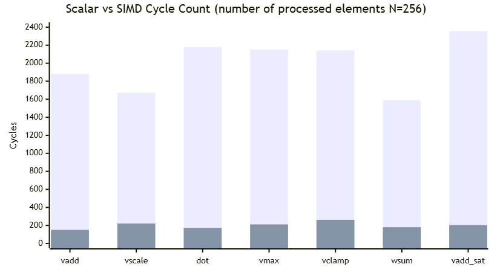
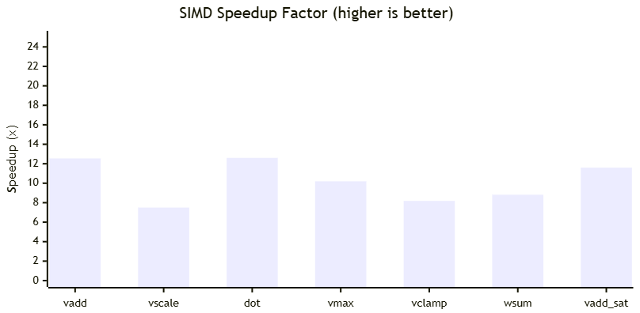

 
# iLLD_TC4Dx_ACS_Examples_PPU

This project contains some vectorized kernels that are running in the vector core of the PPU, while the corresponding scalar kernels are running on the scalar core of the PPU. 
It demonstrates how to write simple vectorized code and the performance gain that can be achieved compared to the scalar implementation. 

**Introduction**    
The following kernels/examples demonstrate practical use cases and a straightforward approach to writing vectorized SIMD implementations alongside scalar reference code for correctness verification. Each kernel includes performance measurements comparing scalar vs. vectorized execution, highlighting the speedup achieved through SIMD parallelism (Please see the image below).

Note that the purpose of Tricore is to wake up the PPU; it performs no other computation.

## Implementation

The project is organized as follows:

- **`src/kernels/`** — SIMD implementations and their scalar reference counterparts (one file per kernel)
- **`src/tests/`** — Test harnesses that initialize data, run both versions, verify correctness, and measure cycle counts
- **`src/kernels/kernels_main.c`** — Main entry point (`main()`) that invokes all kernel tests and prints the results summary

**Note**: The scalar reference code runs on the PPU's embedded scalar core. Since this core shares architectural similarities with the TriCore, and given that the same C code could equally be compiled for TriCore execution, it is reasonable to expect comparable scalar performance between the two — though actual results may vary depending on compiler optimizations, memory subsystem differences, and platform-specific constraints.

**Performance Comparison**



  
**Kernel 1: Vector Add** (`vadd`)

### Practical Use
Element-wise addition is fundamental in signal processing (superposition of signals), image blending, and array accumulation in control systems.

### Functionality
```
c[i] = a[i] + b[i]    for i = 0..N-1
```
Data type: `int8_t` — processes 32 elements per cycle (256-bit / 8-bit).

### Intrinsics Used
<table border="1" cellpadding="4" cellspacing="0" style="border-collapse:collapse; border:1px solid #ccc;">
  <tr><th>Intrinsic</th><th>Purpose</th></tr>
  <tr><td><code>vvld</code></td><td>Load 32 × int8 from VCCM into vector register</td></tr>
  <tr><td><code>vvadd</code></td><td>Element-wise 8-bit addition</td></tr>
  <tr><td><code>vvst</code></td><td>Store vector register to VCCM</td></tr>
</table>

### Performance
<table border="1" cellpadding="4" cellspacing="0" style="border-collapse:collapse; border:1px solid #ccc;">
  <tr><th>Metric</th><th>Cycles</th></tr>
  <tr><td>Scalar</td><td>1883</td></tr>
  <tr><td>SIMD</td><td>150</td></tr>
  <tr><td><b>Speedup</b></td><td><b>12.55x</b></td></tr>
</table>

---

**Kernel 2: Vector Scale** (`vscale`)

### Practical Use
Gain adjustment in audio processing, brightness scaling in image processing, applying a fixed coefficient in control loops.

### Functionality
```
output[i] = input[i] * scale    for i = 0..N-1
```
Data type: `int16_t` — processes 16 elements per cycle (256-bit / 16-bit).

### Intrinsics Used
<table border="1" cellpadding="4" cellspacing="0" style="border-collapse:collapse; border:1px solid #ccc;">
  <tr><th>Intrinsic</th><th>Purpose</th></tr>
  <tr><td><code>vvld</code></td><td>Load 16 × int16 from VCCM</td></tr>
  <tr><td><code>vvmpy</code></td><td>Element-wise 16-bit multiply (truncated to 16-bit)</td></tr>
  <tr><td><code>vvst</code></td><td>Store result vector to VCCM</td></tr>
</table>

### Performance
<table border="1" cellpadding="4" cellspacing="0" style="border-collapse:collapse; border:1px solid #ccc;">
  <tr><th>Metric</th><th>Cycles</th></tr>
  <tr><td>Scalar</td><td>1672</td></tr>
  <tr><td>SIMD</td><td>221</td></tr>
  <tr><td><b>Speedup</b></td><td><b>7.5x</b></td></tr>
</table>

---

**Kernel 3: Dot Product (`dot`)** — float32

### Practical Use
Neural network inference (weight × activation), cosine similarity, correlation computation, FIR filter tap evaluation.

### Functionality
```
result = sum(a[i] * b[i])    for i = 0..N-1
```
Data type: `float32` — processes 8 elements per cycle. Result is a scalar float reduced from all vector lanes.

### Intrinsics Used
<table border="1" cellpadding="4" cellspacing="0" style="border-collapse:collapse; border:1px solid #ccc;">
  <tr><th>Intrinsic</th><th>Purpose</th></tr>
  <tr><td><code>vvld</code></td><td>Load 8 × float32 (via int32 pointer cast + reinterpret)</td></tr>
  <tr><td><code>vvfmul</code></td><td>Element-wise float multiply</td></tr>
  <tr><td><code>vvfadd</code></td><td>Element-wise float addition (accumulate partial products)</td></tr>
  <tr><td><code>vvst</code></td><td>Store accumulator vector for scalar reduction</td></tr>
  <tr><td><code>vvffadd</code></td><td>Reduce all lanes to a scalar</td></tr>
</table>

### Performance
<table border="1" cellpadding="4" cellspacing="0" style="border-collapse:collapse; border:1px solid #ccc;">
  <tr><th>Metric</th><th>Cycles</th></tr>
  <tr><td>Scalar</td><td>2179</td></tr>
  <tr><td>SIMD</td><td>173</td></tr>
  <tr><td><b>Speedup</b></td><td><b>12.6x</b></td></tr>
</table>

---

**Kernel 4: Vector Max** (`vmax`)

### Practical Use
ReLU activation in neural networks (`max(x, 0)`), peak detection, envelope extraction in audio/vibration analysis.

### Functionality
```
c[i] = max(a[i], b[i])    for i = 0..N-1
```
Data type: `int32_t` — 8 lanes per operation.

### Intrinsics Used
<table border="1" cellpadding="4" cellspacing="0" style="border-collapse:collapse; border:1px solid #ccc;">
  <tr><th>Intrinsic</th><th>Purpose</th></tr>
  <tr><td><code>vvld</code></td><td>Load 8 × int32 from VCCM</td></tr>
  <tr><td><code>vvmax</code></td><td>Element-wise signed maximum</td></tr>
  <tr><td><code>vvst</code></td><td>Store result vector</td></tr>
</table>

### Performance
<table border="1" cellpadding="4" cellspacing="0" style="border-collapse:collapse; border:1px solid #ccc;">
  <tr><th>Metric</th><th>Cycles</th></tr>
  <tr><td>Scalar</td><td>2151</td></tr>
  <tr><td>SIMD</td><td>211</td></tr>
  <tr><td><b>Speedup</b></td><td><b>10.2x</b></td></tr>
</table>

---

**Kernel 5: Vector Clamp** (`vclamp`)

### Practical Use
Pixel value clamping (0–255), actuator saturation limits in control systems, ADC output range enforcement.

### Functionality
```
dst[i] = clamp(src[i], lo, hi)    for i = 0..N-1
       = max(min(src[i], hi), lo)
```
Data type: `int32_t` — chained min/max for branchless clamping.

### Intrinsics Used
<table border="1" cellpadding="4" cellspacing="0" style="border-collapse:collapse; border:1px solid #ccc;">
  <tr><th>Intrinsic</th><th>Purpose</th></tr>
  <tr><td><code>vvld</code></td><td>Load source vector + broadcast lo/hi constants</td></tr>
  <tr><td><code>vvmin</code></td><td>Element-wise minimum (upper bound)</td></tr>
  <tr><td><code>vvmax</code></td><td>Element-wise maximum (lower bound)</td></tr>
  <tr><td><code>vvst</code></td><td>Store clamped result</td></tr>
</table>

### Performance
<table border="1" cellpadding="4" cellspacing="0" style="border-collapse:collapse; border:1px solid #ccc;">
  <tr><th>Metric</th><th>Cycles</th></tr>
  <tr><td>Scalar</td><td>2143</td></tr>
  <tr><td>SIMD</td><td>262</td></tr>
  <tr><td><b>Speedup</b></td><td><b>8.18x</b></td></tr>
</table>

---

**Kernel 6: Weighted Sum** (`wsum`)

### Practical Use
FIR filter per-tap output, element-wise weighting in weighted averaging, attention score × value in transformers.

### Functionality
```
output[i] = data[i] * weights[i]    (16-bit × 16-bit → 32-bit)
```
Data type: `int16_t` input → `int32_t` output. Uses the hardware accumulator for widening multiply.

### Intrinsics Used
<table border="1" cellpadding="4" cellspacing="0" style="border-collapse:collapse; border:1px solid #ccc;">
  <tr><th>Intrinsic</th><th>Purpose</th></tr>
  <tr><td><code>vvld</code></td><td>Load 16 × int16 from VCCM</td></tr>
  <tr><td><code>vvcmpy</code></td><td>16-bit complex/widening multiply → 64-bit accumulator</td></tr>
  <tr><td><code>__vacc_lo</code></td><td>Extract low 32 bits of each accumulator lane</td></tr>
  <tr><td><code>vvst</code></td><td>Store 32-bit result (via union type-pun from accumulator)</td></tr>
</table>

### Performance
<table border="1" cellpadding="4" cellspacing="0" style="border-collapse:collapse; border:1px solid #ccc;">
  <tr><th>Metric</th><th>Cycles</th></tr>
  <tr><td>Scalar</td><td>1589</td></tr>
  <tr><td>SIMD</td><td>180</td></tr>
  <tr><td><b>Speedup</b></td><td><b>8.82x</b></td></tr>
</table>

---

**Kernel 7: Saturating Add** (`vadd_sat`)


### Practical Use
Audio mixing without clipping, safe accumulation in fixed-point DSP, sensor fusion where overflow must be prevented.

### Functionality
```
c[i] = saturate(a[i] + b[i])    clamped to [-32768, 32767]
```
Data type: `int16_t` — 16 lanes per operation. Hardware saturation prevents overflow wrap-around.

### Intrinsics Used
<table border="1" cellpadding="4" cellspacing="0" style="border-collapse:collapse; border:1px solid #ccc;">
  <tr><th>Intrinsic</th><th>Purpose</th></tr>
  <tr><td><code>vvld</code></td><td>Load 16 × int16 from VCCM</td></tr>
  <tr><td><code>vvadd_sat</code></td><td>Saturating 16-bit addition (clamps on overflow)</td></tr>
  <tr><td><code>vvst</code></td><td>Store result vector</td></tr>
</table>

### Performance
<table border="1" cellpadding="4" cellspacing="0" style="border-collapse:collapse; border:1px solid #ccc;">
  <tr><th>Metric</th><th>Cycles</th></tr>
  <tr><td>Scalar</td><td>2356</td></tr>
  <tr><td>SIMD</td><td>203</td></tr>
  <tr><td><b>Speedup</b></td><td><b>11.6x</b></td></tr>
</table>

---

## References

AURIX&trade; Configuration Studio is available online:  
- <https://www.infineon.com/aurixconfigurationstudio>  
- Use the "Import..." function to get access to more code examples  

More code examples can be found on the GIT repository:  
- <https://github.com/Infineon/AURIX_code_examples>  

For additional trainings, visit our webpage:  
- <https://www.infineon.com/aurix-expert-training>  

For questions and support, use the AURIX&trade; Forum:  
- <https://community.infineon.com/t5/AURIX/bd-p/AURIX>  


