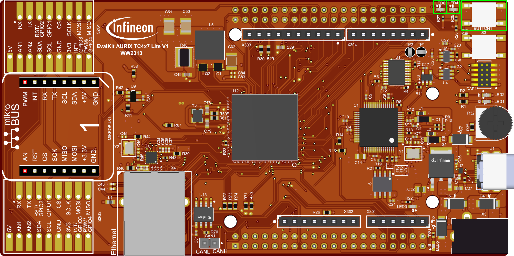
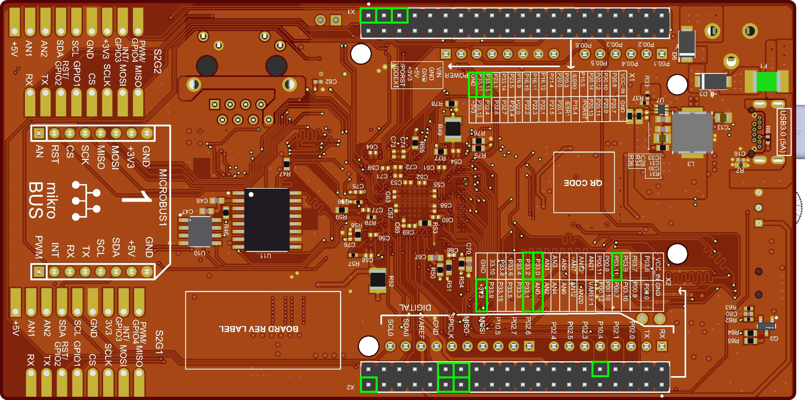
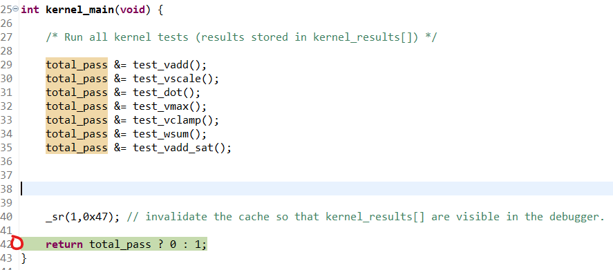
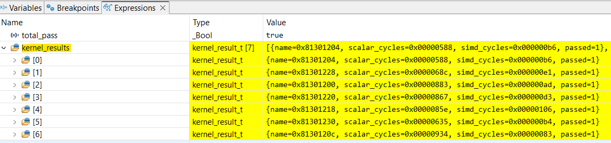

  

# iLLD_TC4Dx_ACS_Examples_TC4
**A collection of vectorized kernels for the Infineon AURIX&trade; TC4x PPU (A Vector DSP), demonstrating various SIMD intrinsics and programming patterns on the 256-bit VPX datapath.**

## Device  

The device used in this example is AURIX™ TC4D7Xx_A-Step. 

## Board  

The board used for testing is the AURIX™ TC4D7 Lite Kit (KIT_A3G_TC4D7_LITE).

## Scope of work  

This project contains some vectorized kernels that are running in the vector core of the PPU, while the corresponding scalar kernels are running on the scalar core of the PPU. 
It demonstrates how to write simple vectorized code and the performance gain that can be achieved compared to the scalar implementation. 

## Introduction

This example project has to sub project: 
- **Host project (TriCore&trade;)** — Its sole purpose is to wake up the PPU; it performs no other computation.
- **PPU project** — Please refer to the corresponding README.

## Hardware setup  

This code example has been developed for the board KIT_A3G_TC4D7_LITE (AURIX™ TC4D7 Lite Kit).

**Top view**

Top view of the AURIX™ TC4x7 Lite Kit V2. Used button and LEDs are marked with a green frame.

- **BUTTON1 (P03.11)** is the button on the top right.
- **LED1 (P03.9)** is the right LED on the top right, near BUTTON1.
- **LED2 (P03.10)** is the left LED on the top right.

**Bottom view**

Bottom view of the AURIX™ TC4x7 Lite Kit V2. Used Pins are marked with a green frame.

- **X1** is the 40-pin connector on the top. Pin 1 marking is on the top left.
- **X2** is the 40-pin connector on the bottom. Pin 1 marking is on the bottom right.

## Implementation
  
Please refer to the PPU README.

## Compiling and programming

Before testing this code example:  
- Power the board through the dedicated power connector 
- Connect the board to the PC through the USB interface
- Build the project using the dedicated Build button  or by right-clicking the project name and selecting "Build Project"
- To flash the device and debug (Tricore&trade; + PPU) the program, click on the dedicated Debug button 

## Run and Test

- This project focuses exclusively on demonstrating PPU SIMD performance versus scalar execution. The TriCore™ host code only initializes and wakes up the PPU — it performs no other computation.
- To inspect results, place a breakpoint at the end of `Kernel_main()` in `iLLD_TC4Dx_ACS_Examples_PPU/src/kernels/kernels_main.c` (as shown in the image below), then start a debug session.

In the debugger's expression/watch window, add `kernel_results` to view the cycle counts, speedup, and pass/fail status for each kernel (as shown in the following image).

## References

AURIX&trade; Configuration Studio is available online:  
- <https://www.infineon.com/aurixconfigurationstudio>  
- Use the "Import..." function to get access to more code examples  

More code examples can be found on the GIT repository:  
- <https://github.com/Infineon/AURIX_code_examples>  

For additional trainings, visit our webpage:  
- <https://www.infineon.com/aurix-expert-training>  

For questions and support, use the AURIX&trade; Forum:  
- <https://community.infineon.com/t5/AURIX/bd-p/AURIX>   

