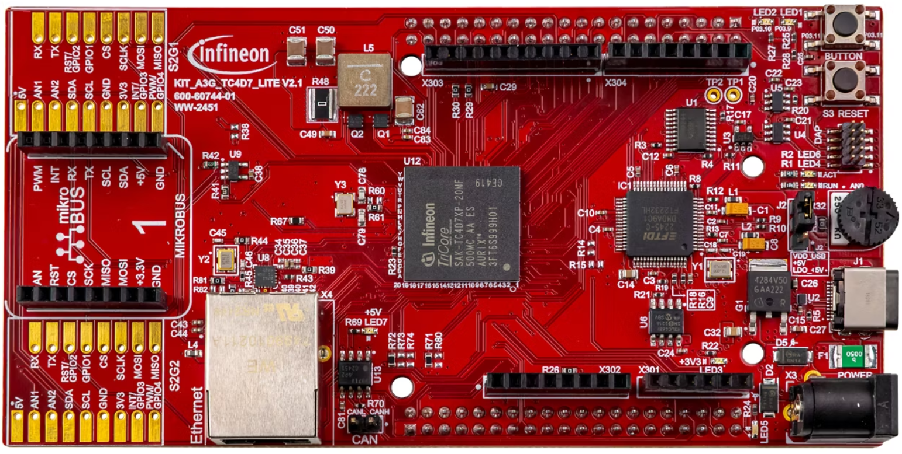
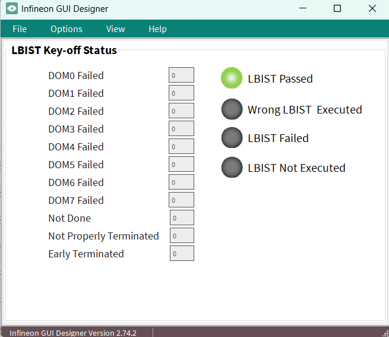

  

# iLLD_TC4D7_ACS_LBIST_KEY_OFF
**Evaluation of a full MCU logic LBIST test (Key-off).** 

## Device  
The device used in this example is AURIX&trade; TC4D7Xx_A-Step

## Board  
The board used for testing is the AURIX&trade; TC4D7 Lite Kit (KIT_A3G_TC4D7_LITE)

## Scope of work   
This code example demonstrates the configuration, triggering, and evaluation of a Key-Off LBIST on 
AURIX&trade; TC4xx. The implementation covers full-scan execution across all hierarchical scan domains. 
Upon completion, the MISR signature results are compared against the expected device-specific 
reference values and the test outcome is immediately reflected via dedicated status LEDs through the 
Infineon OneEye GUI.
## Introduction  

The Logic Built-In Self-Test (LBIST) enables detection of permanent hardware faults within the MCU logic.

Once triggered, LBIST execution is fully autonomous — no software intervention is required during the test. Upon completion, the test results are captured in dedicated Special Function Registers (SFRs) and an internal cold PORST is triggered automatically. Following this reset, application software is responsible for evaluating the MISR signature results and taking the appropriate action based on the outcome.

Two LBIST test scenarios are supported in the TC4Dx device:
1. Key-on LBIST: Targets only faults in the on-chip functional safety logic (safety requirement)
2. Key-off LBIST: Targets faults in all on-chip logic (diagnostic feature)
 
This code example focuses on the Key-off LBIST scenario. The full on chip logic is tested by configuring the LBIST control registers with the Key-Off setting provided in the device user's manual. 
After test execution and LBIST reset event, the test result is evaluated and hierarchical domains signatures are compared to reference values that are available in the device user's manual.
      
## Hardware setup  
This code example has been developed for the board KIT_A3G_TC4D7_LITE

   

## Implementation
This code example doesn't configure the FIRMWARE to trigger LBIST upon a cold-power on reset. LBIST Key-off can be triggered only by application software.

Immediately after reset, the code example gets the reset status using the following function:
    
    - IfxSmmRst_evaluateReset() 

Afterward, the LBIST execution is evaluated by the *handleLbistKeyoffCompleted()* function as follows.
 
    -   Reset all LED flags to FALSE by "resetLbistStatusLeds()" function
    -   Check reset origin — proceed if last reset was Cold PORST or warm PORST, otherwise set oneEyeLed4LbistNotExecuted and exit.
        -   Check if LBIST finished (IfxTriLbist_isDone) — if not (after first boot, since LBIST is to be triggered by Software), clear reset registers and trigger Key-off LBIST.
        -   If done, evaluate the LBIST result (LBIST not interrupted by PORST, LBIST terminated properly, LBIST done for each domain and accordingly MISR signature) read safety/session indications and fail count, then reset the LBIST module.
        -   If result is successful and is key-off run :
            -   Turn on oneEyeLed0LbistPassed,
        -   If result is successful and is not key-off run
            -   Wrong type/session → oneEyeLed3WrongLbist turns on.
        -   If result failed:
            -   Turn on oneEyeLed3LbistFailed.

Finally, clear the reset registers once LBIST has completed successfully.

    -   IfxSmmRst_clearAllResetRegisters()

**Note:** According to returned test result, LEDs are used to showcase the LBIST result (as explained in Run and Test section)

**Infineon OneEye GUI:**

The graphical user interface (GUI) used for this project is called Infineon OneEye GUI. OneEye is a front-end software used to create custom GUI for embedded application. This GUI interface is integrated into the AURIX&trade; Configuration Studio (ACS). The system operates in real-time and communicates through various interfaces such as UART, Ethernet, CAN, or DAS. 

The custom GUI design for AURIX&trade; TC4D7 Lite Kit shows the output of global variables that are linked to the implemented code example. The real-time data and status are displayed.
The LEDs available have two state i.e on state (green) and off state (gray)

    

The figure below shows the custom GUI design for this code example.

 

**Note:** To open the GUI, double-click `iLLD_TC4D7_ACS_LBIST_KEY_OFF.OneEye`.

## Compiling and programming

Before testing this code example: 
- Power the board through the dedicated power connector 
- Connect the board to the PC through the USB interface
- Build the project using the dedicated Build button  or by right-clicking the project name and selecting "Build Project"
- To flash the device and immediately run the program, click on the dedicated Flash button 
    - Please select "Flash active project (with Boot mode Header)", so the UCB registers are also updated.

## Run and Test  
After code compilation and flashing the device, the result status can be observed by following LEDs. 

- LBIST Passed:                
    -   (oneEyeLed0LbistPassed) turn on if LBIST execution is successful upon a cold power-on reset.
    
- The LBIST Passed in first attempt:  
    -   (oneEyeLed1WrongLbist) turns on if LBIST executed is not the correct one.   
    
- The LBIST Failed:   
    -   (oneEyeLed2LbistFailed) turn on if LBIST execution is failed. 
    
- The LBIST Not Executed:             
    -   (oneEyeLed3LbistNotExecuted) turn on if LBIST is not executed. 
    
## References  

AURIX&trade; Configuration Studio is available online:  
- <https://www.infineon.com/aurixconfigurationstudio>  
- Use the „Import“... function to get access to more code examples  

More code examples can be found on the GIT repository:  
- <https://github.com/Infineon/AURIX_code_examples>  

For additional trainings, visit our webpage:  
- <https://www.infineon.com/aurix-expert-training>  

For questions and support, use the AURIX&trade; Forum:  
- <https://community.infineon.com/t5/AURIX/bd-p/AURIX>  

