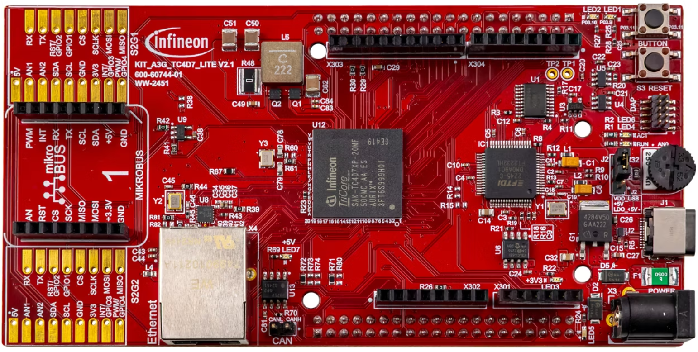
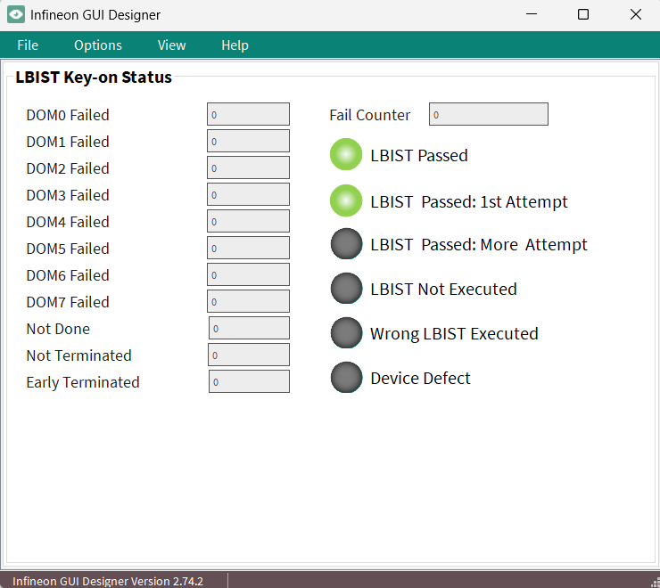

  

# iLLD_TC4D7_ACS_LBIST_KEY_ON
**Evaluation of a safety logic LBIST test (Key-on) trigger by Firmware.** 

## Device  
The device used in this example is AURIX&trade; TC4D7Xx_A-Step

## Board  
The board used for testing is the AURIX&trade; TC4D7 Lite Kit (KIT_A3G_TC4D7_LITE)

## Scope of work   
This code example demonstrates the configuration, triggering, and evaluation of a Key-On LBIST on
AURIX&trade; TC4xx. The implementation covers safety-logic execution across all hierarchical scan domains.
Upon completion, the MISR signature results are compared against the expected device-specific
reference values and the test outcome is immediately reflected via dedicated status LEDs through the 
Infineon OneEye GUI.

## Introduction  

The Logic Built-In Self-Test (LBIST) enables detection of permanent hardware faults within the MCU logic.

Once triggered, LBIST execution is fully autonomous — no software intervention is required during the test. Upon completion, the test results are captured in dedicated Special Function Registers (SFRs) and an internal cold PORST is triggered automatically. Following this reset, application software is responsible for evaluating the MISR signature results and taking the appropriate action based on the outcome.

Two LBIST test scenarios are supported in the TC4Dx device:
1. Key-on LBIST: Targets only faults in the on-chip functional safety logic (safety requirement)
2. Key-off LBIST: Targets faults in all on-chip logic (diagnostic feature)
 
The start-up FIRMWARE can be configured to automatically trigger the LBIST upon a cold power-on reset (UCB registers are used for this). 
Once enabled to be triggered by FIRMWARE, the LBIST will execute a logic test with the Key-On configuration (for more details about LBIST Key-on please refer to the User Manual). 
      
## Hardware setup  
This code example has been developed for the board KIT_A3G_TC4D7_LITE

   

## Implementation
This code example configures the FIRMWARE to trigger LBIST Key-on upon a cold power-on reset. For this, the UCB configuration is changed in the *../Configurations/Ifx_Cfg_SswBmhd.c* file.

    -   The update consists of setting „LBIST triggered by FW“ in the UCB0 (*usercfg_0_orig.lbistExe = 0x07030000*), the CRC of the UCB0 is updated accordingly (in *usercfg_0_orig.crcRtcUserCfg*).

**Note:** The user shall ensure that the updated UCB with LBIST enabled is successfully flashed.

The code example is implemented in the following way:

Immediately after reset, the code example gets the reset status using the following function:
    
    - IfxSmmRst_evaluateReset() 

Afterward, the LBIST execution is evaluated by the *handleLbistKeyonCompleted()* function as follows.
 
    -   Reset all LED flags to FALSE by resetLbistExecutionStatus() function.
    -   Check reset origin — only proceed if last reset was Cold PORST reset, otherwise set oneEyeLed4LbistNotExecuted and exit.
        -   Evaluate the LBIST result (check if LBIST was interrupted by PORST, check if LBIST terminated properly via LBTERM, check DONE flag per domain, and compare MISR signatures accordingly). 
        -   If result is successful:
            -   Read safety indication, session indication, and fail count, then reset the LBIST module.
            -   Verify it was the correct test type (safety-only + key-on session).
            -   Turn on oneEyeLed0LbistPassed, plus oneEyeLed1LbistPassedFirstRun (first try) or oneEyeLed2LbistPassedMoreRun (after retries) based on failCount.
            -   Wrong type/session → oneEyeLed3WrongLbist turns on.
        -   If result is not performed (LBTERM == 0 and DONE == 0):
            -   mean LBIST key-on was not trigger by Firmware, therefore set oneEyeLed4LbistNotExecuted and exit.
        -   If result failed:
            -   Retry if failCount < MAX_FAIL_COUNT (increment count, clear reset registers, re-trigger LBIST).
            -   Otherwise → oneEyeLed5DeviceDefect turns on.

Finally, clear the reset registers once LBIST has completed successfully.

    -   IfxSmmRst_clearAllResetRegisters()

**Note:** According to returned test result, LEDs are used to showcase the LBIST result (as explained in Run and Test section)

**Infineon OneEye GUI:**

The graphical user interface (GUI) used for this project is called Infineon OneEye GUI. OneEye is a front-end software used to create custom GUI for embedded application. This GUI interface is integrated into the AURIX&trade; Configuration Studio (ACS). The system operates in real-time and communicates through various interfaces such as UART, Ethernet, CAN, or DAS. 

The custom GUI design for AURIX&trade; TC4D7 Lite Kit shows the output of global variables that are linked to the implemented code example. The real-time data and status are displayed.
The LEDs available have two state i.e on state (green) and off state (gray)

    

The figure below shows the custom GUI design for this code example.

 

**Note:** To open the GUI, double-click `iLLD_TC4D7_ACS_LBIST_KEY_ON.OneEye`.

## Compiling and programming

Before testing this code example: 
- Power the board through the dedicated power connector 
- Connect the board to the PC through the USB interface
- Build the project using the dedicated Build button  or by right-clicking the project name and selecting "Build Project"
- To flash the device and immediately run the program, click on the dedicated Flash button 
    - Please select "Flash active project (with Boot mode Header)", so the UCB registers are also updated.

## Run and Test  
After code compilation and flashing the device, the result status can be observed by following LEDs via OneEye GUI. 

- LBIST Passed:                
    -   (oneEyeLed0LbistPassed) turn on if LBIST execution is successful upon a cold power-on reset.
    
- The LBIST Passed in first attempt:  
    -   (oneEyeLed1LbistPassedFirstRun) turn on if LBIST execution is successful in first attempt.   
    
- The LBIST Passed in more than attempt:   
    -   (oneEyeLed2LbistPassedMoreRun) turn on if LBIST execution is successful in more than one attempt. 
    
- The LBIST failed more than Maximum allow run:             
    -   (oneEyeLed5DeviceDefect) turn on if LBIST execution is faulty for three consecutive times. 

- The LBIST is not executed:       
    -   (oneEyeLed4LbistNotExecuted) turn on if reset is different than a cold power-on reset.
   
- The LBIST executed is wrong one:               
    -   (oneEyeLed3WrongLbist) turns on if LBIST executed is not the correct one.
  

## References  

AURIX&trade; Configuration Studio is available online:  
- <https://www.infineon.com/aurixconfigurationstudio>  
- Use the „Import“... function to get access to more code examples  

More code examples can be found on the GIT repository:  
- <https://github.com/Infineon/AURIX_code_examples>  

For additional trainings, visit our webpage:  
- <https://www.infineon.com/aurix-expert-training>  

For questions and support, use the AURIX&trade; Forum:  
- <https://community.infineon.com/t5/AURIX/bd-p/AURIX>  

