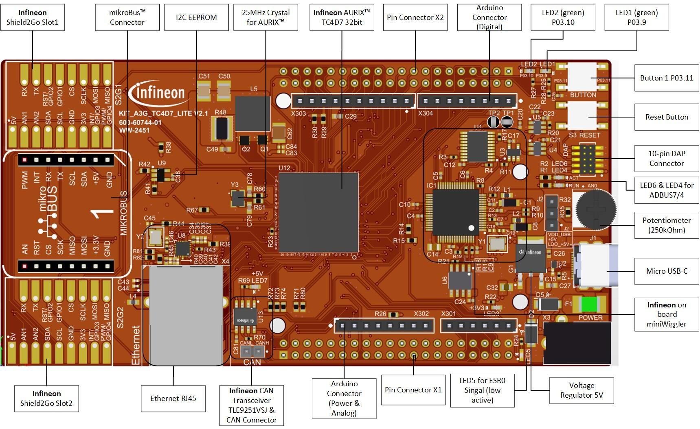
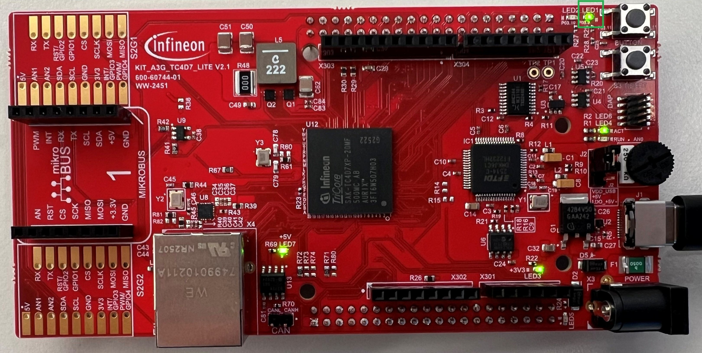

  

# iLLD_TC4D7_LK_ACS_APPs_Blinky_LED

**An LED blinks at 1 Hz using a single PWM app, PWM_EGTM, for both timer generation and I/O output control.**  

## Device  
The device used in this example is the AURIX&trade; TC4D7Xx_A-Step.

## Board  
The board used for testing is the AURIX&trade; TC4D7 Lite Kit (KIT_A3G_TC4D7_LITE).

## Scope of work   
A single PWM timer app, *PWM_EGTM*, is used to generate a 1 Hz signal and drive the LED output directly on port pin P03.9.
No GPIO APP toggling logic and no software wait/delay functions are required.

## Introduction  
- This example demonstrates LED blinking using only the *PWM_EGTM* app.
- The same app handles both timer/frequency calculation (1 Hz) and I/O pin output control for the LED signal.
- By relying on PWM hardware generation, the LED waveform is produced without software delay loops.

## Hardware setup  
This code example has been developed for the AURIX&trade; TC4D7 Lite Kit board (KIT_A3G_TC4D7_LITE).

    

## Implementation  
**PWM-based LED control (single-app approach)**
- The *PWM_EGTM* app generates a 1 Hz PWM signal.
- The PWM output drives the LED on pin *P03.9*.
- A single app, *PWM_EGTM*, handles both timer calculation and I/O pin control.
- **Hardware connectivity**: LED connected to pin P03.9.
- **Pin control**: Managed by PWM_EGTM.

## APP(s) Used

- **PWM_EGTM** - Generates a PWM signal for LED blinking using eGTM.
- **EGTM_GENERIC** - Configures the Clock Management Unit (CMU) for eGTM sub-blocks.
- **CLOCK** - Configures and provides the basic clock for all peripherals, including eGTM.

## Compiling and programming

Before testing this code example:  
- Power the board through the dedicated power connector.
- Connect the board to the PC through the USB interface.
- Build the project using the dedicated Build button  or by right-clicking the project name and selecting "Build Project".
- To flash the device and immediately run the program, click the dedicated Flash button .

## Run and Test   
After code compilation and flashing the device, observe LED P03.9 blinking at a frequency of approximately 1 Hz.
The blinking is generated by the PWM hardware timer/output.

  

## References  

AURIX&trade; Configuration Studio is available online:  
- <https://www.infineon.com/aurixconfigurationstudio>  
- Use the "Import..." function to get access to more code examples  

More code examples can be found on the GIT repository:  
- <https://github.com/Infineon/AURIX_code_examples>  

For additional trainings, visit our webpage:  
- <https://www.infineon.com/aurix-expert-training>  

For questions and support, use the AURIX&trade; Forum:  
- <https://community.infineon.com/t5/AURIX/bd-p/AURIX>  
