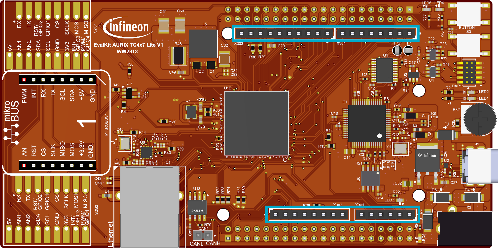
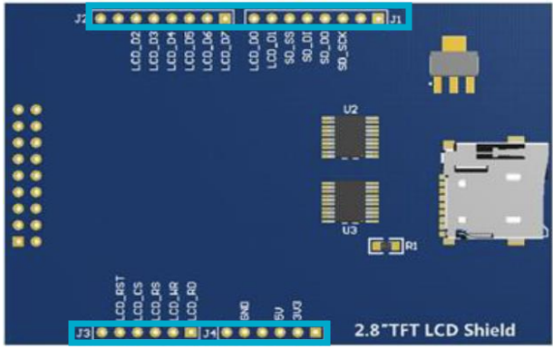
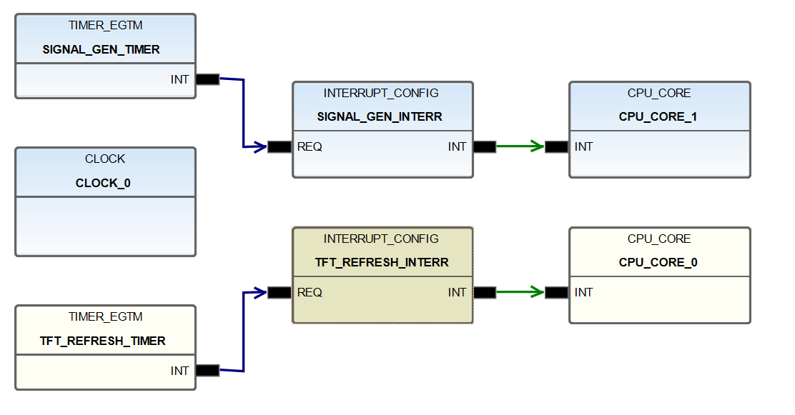
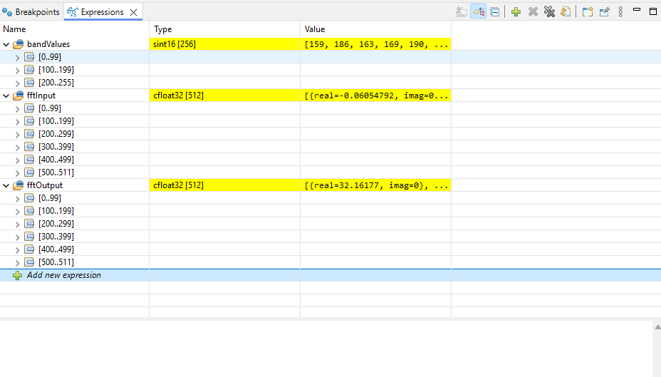

  

# iLLD_TC4D7_LK_ACS_TFT_SPECTRUM_EXAMPLE

**CPU0 initializes the thin-film-transistor (TFT) display and renders the spectrum visualization. CPU1 generates a synthetic audio signal and computes the Fast Fourier Transform (FFT) to extract frequency content.**

## Device

The device used in this example is AURIX™ TC4D7Xx_A-Step

## Board

The board used for testing is the AURIX™ TC4D7LITE (KIT_A3G_TC4D7_LITE)

## Scope of work

This code example demonstrates a real-time 256-band spectrum analyzer that showcases multi-core processing capabilities of the TC4D. A synthetic audio signal is generated and processed using FFT to display frequency content as animated LED-style bars on a TFT LCD display.

The example shows how to distribute workload across multiple CPU cores, with CPU0 handling display rendering and CPU1 handling signal processing.

## Introduction

- The Radix-2 FFT algorithm, provided by Infineon Low Level Drivers (iLLDs), is used to compute a 512-point FFT
- A synthetic audio signal is generated containing multiple frequency components (kick drum, bass, synths, hi-hats)
- TFT display library provides graphics primitives for rendering the spectrum bars
- Multi-core synchronization is achieved using `IfxCpu_syncEvent` and memory barriers (`__dsync()`)
- 256 frequency bands are displayed as segmented LED-style bars with color gradient from green to red

## Hardware setup

This code example has been developed for the AURIX™ TC4D Application Kit.

  
<br clear="all" />

In this example, a TFT LCD Shield is connected to the board via the GPIO pins as configured in `TC4_HAL.h`.

  
<br clear="all" />

To configure correctly the LCD screen the key parameters in `TFT_LCD_TC4.h` should be adjusted:

```c
#define TFTLCD_WIDTH   240 //LCD Screen width
#define TFTLCD_HEIGHT  320 //LCD Screen height
```

The board should be connected to the PC via USB to allow flashing and debugging.

**Note:** Larger TFT shields may mechanically interfere with the Ethernet port on the board. If this occurs, an extension shield (pin header extender) can be used to raise the TFT shield and bypass this issue.

## Implementation

### Multi-core architecture

This project distributes workload across two CPU cores:

- **CPU0**: TFT display initialization and spectrum rendering
- **CPU1**: Signal generation and FFT computation
- **CPU2-5**: Unused (available for extension)

### Data flow between cores

- **CPU1** generates a synthetic audio signal and computes the 512-point FFT
- The frequency magnitudes are stored in the shared `bandValues[256]` array
- **CPU0** reads `bandValues[]` and renders the spectrum bars on the TFT display

### Configuration of the FFT module

The function used to compute the FFT transform is `Ifx_FftF32_radix2()` found in the iLLD header *Ifx_FftF32.h*. Its input parameters are:

- *R* - pointer to *cfloat32* array that contains the result of FFT
- *X* - pointer to *cfloat32* array that contains the input signal samples
- *nX* - size of array (must be power of 2), defines the frequency resolution

Key variables in `TC4_Spectrum_Example.c`:

- *fftInput* - containing the generated signal samples
- *fftOutput* - containing the result of FFT transform
- *bandValues* - containing the magnitude of frequency components for display

### Configuration of the TFT display

The TFT display is initialized in `spectrum_example_setup()` function:

- `TFTLCD_init()` - initializes the LCD hardware
- `TFTLCD_begin()` - configures the LCD controller (ILI9341)
- `TFTLCD_setRotation()` - sets landscape mode

The spectrum rendering is performed in `spectrum_example_refresh()` which reads `bandValues[]` and draws segmented LED-style bars.

### Signal generation

The `spectrum_generate_signal()` function creates a synthetic audio signal containing:

- Kick drum pattern (4-on-the-floor)
- Bass synth with harmonics
- Snare/hi-hat patterns
- Sweeping synth pads and arpeggios
- Random sparkles and ambient textures

### Project file structure

- `Cpu0_Main.c` - CPU0 entry point, initializes display and triggers rendering
- `Cpu1_Main.c` - CPU1 entry point, signal generation and FFT processing
- `Cpu2_Main.c` - `Cpu5_Main.c` - Unused cores (template only)
- `TC4_Spectrum_Example.c` - Core implementation: signal generation, FFT, and rendering
- `TC4_Spectrum_Example.h` - Public API header for cross-core functions
- `Configurations/` - DAVE configuration and startup files
- `Libraries/Tft_lib_iLLD/` - iLLDs adapted TFT display library (TFT_GFX, TFT_LCD)
- `Libraries/iLLD/` - Infineon Low-Level Drivers

## APP(s) Used

This project uses the following APPs for peripheral configuration:

- **CLOCK** - Configures all system clock settings for TC4xx, including PLL configuration, clock dividers, and peripheral clock distribution. Ensures the CPU and peripherals run at the correct frequencies.

- **CPU_CORE** - Manages multi-core CPU configuration. Handles core startup sequencing and provides synchronization primitives for inter-core communication.

- **INTERRUPT_CONFIG** - Configures interrupt service requests from peripherals. Sets up interrupt priority, CPU assignment, and connects the timer overflow event to the ISR handler.
    - **TFT REFRESH INTERRUPT** - refreshes the spectrum with the current values
    - **SIGNAL GENERATION INTRERRUPT** - generates a new mocked signal starting from the current one

- **TIMER_EGTM** - Configures the EGTM peripheral as a timer. Used to generate periodic interrupts that trigger the display refresh and signal processing routines.
    - **UI REFRESH TIMER** - generates an interrupt every 30000us (refresh rate around 30fps)
    - **SIGNAL GENERATION TIMER** - generates an interrupt every 100000us

- **EGTM_GENERIC** - This APP configures the Clock Management Unit (CMU), which provides clocks to the various submodules of the eGTM.

  
<br clear="all" />

## Compiling and programming

Before testing this code example:

- Connect the board (with the TFT screen) to the PC through the USB interface 
- Build the project using the dedicated Build button  or by right-clicking the project name and selecting "Build Project"
- To flash the device and immediately run the program, click on the dedicated Flash button  

## Run and Test

After code compilation and flashing the device, you can observe the following behavior:

<video width="500" controls>
  <source src="./Images/video.mp4" type="video/mp4">
</video>
<br clear="all" />

To debug this code:
- Start a debug  session and resume execution of all cores. The spectrum analyzer will begin displaying animated frequency bars on the TFT LCD (as seen above).
- The synthetic signal cycles through various patterns, creating a dynamic visualization. Key parameters can be adjusted in `TC4_Spectrum_Example.h`:

```c
#define FFT_SIZE        512     // FFT length (power of 2)
#define SAMPLE_RATE     44100.0f// Simulated sample rate in Hz
#define NUM_BANDS       256     // Number of frequency bands
#define NUM_SEGMENTS    44      // LED segments per bar
```

- To inspect the FFT calculation, add variables *fftInput*, *fftOutput*, and *bandValues* to the Expression view in the debugger.

  
<br clear="all" />

## References

AURIX™ Configuration Studio is available online:
- <https://www.infineon.com/aurixconfigurationstudio>
- Use the "Import..." function to get access to more code examples

More code examples can be found on the GIT server:
- <https://github.com/Infineon/AURIX_code_examples>

For additional trainings, visit our webpage:
- <https://www.infineon.com/aurix-expert-training>

For questions and support, use the AURIX™ Forum:
- <https://community.infineon.com/t5/AURIX/bd-p/AURIX>

---

Copyright (C) Infineon Technologies AG 2019
