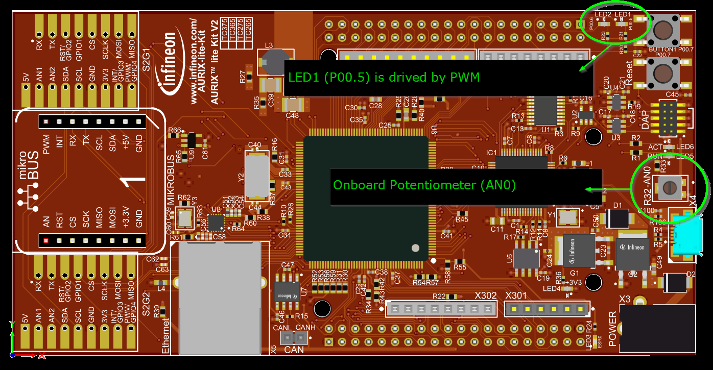
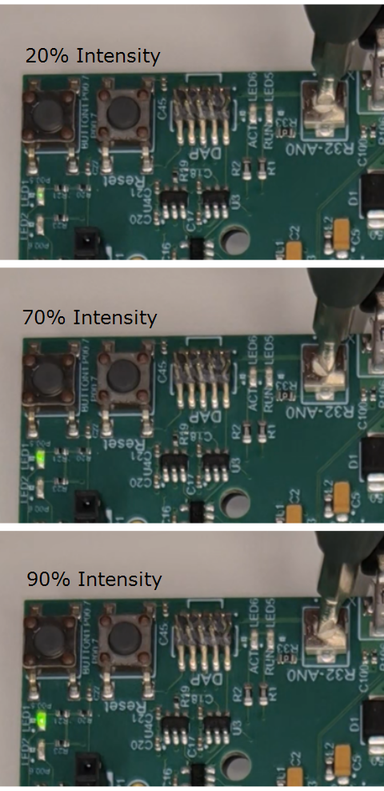

  

# iLLD_TC375_LK_ACS_APPs_LED_Intensity

**A CCU6-triggered EVADC conversion is transferred by DMA to RAM and used to control LED intensity through PWM.**

## Device  
The device used in this example is the AURIX&trade; TC375Tx_A-Step.

## Board  
The board used for testing is the AURIX&trade; TC375 lite Kit (KIT_A2G_TC375_LITE).

## Scope of work   
The onboard potentiometer is sampled by EVADC group 0, channel 0. DMA transfers the result
register value to RAM, and a DMA interrupt updates the PWM duty cycle for LED1.

## Introduction  
- The *TIMER_CCU6* app generates a periodic 100 ms event used as the EVADC conversion trigger.
- The *ANALOG_CONVERTER_EVADC* app converts the analog input of channel 0 in group 0 (AN0/POTI1).
- The *DMA_CHANNEL_CONFIG* app moves the EVADC group result register into a RAM variable on every
  conversion done event, so the CPU is not involved in the data transfer.
- The *INTERRUPT_CONFIG* app routes the DMA channel interrupt to CPU0, where the ADC value is
  converted into a duty cycle.
- The *PWM_GTM* app outputs a 10 kHz PWM signal on P00.5. Its duty cycle sets the LED intensity.

## Hardware setup  
This code example has been developed for the AURIX&trade; TC375 lite Kit board (KIT_A2G_TC375_LITE).

No external wiring is required. Both the analog source and the LED are available on the board:

| Signal | Pin | Board element |
| --- | --- | --- |
| Analog input | AN0 | Potentiometer POTI1 |
| PWM output | P00.5 | LED1 |

The annotated board view below shows the onboard potentiometer connected to AN0 and LED1 driven
by the PWM output on P00.5.



## Implementation  
**Periodic ADC trigger**
- *TIMER_CCU6_0* runs timer T12 at 390 625 Hz with a period value of 39 061, which results in a
  period match roughly every 100 ms.
- The period match is used as EVADC trigger source (rising edge), so conversions are started
  entirely in hardware.

**Conversion and DMA transfer**
- *ANALOG_CONVERTER_EVADC_0* is configured for group 0, channel 0, result register 0.
- On the conversion done event, *DMA_CHANNEL_CONFIG_0* performs a single 32-bit move from the
  EVADC group result register to the global variable `gAdcValue` in `Cpu0_Main.c`.
- The DMA channel operates in continuous mode, so it stays armed for the next conversion without
  being re-initialized.

### DMA address configuration

The DMA source address is `0xF0020700`, which is the TC375 SFR address of `EVADC_G0_RES0`.
The destination is the application-owned RAM variable `gAdcValue` in `Cpu0_Main.c`:

```text
EVADC_G0_RES0 (0xF0020700) -> gAdcValue -> ledIntensity() -> PWM_GTM_SetDuty()
```

Configure the DMA CHANNEL_CONFIG APP as follows:

| Setting | Value |
| --- | --- |
| Channel Data Width | 32-bit |
| Number of Transfers / Moves | 1 / 1 |
| Transfer Mode | Continuous |
| DMA Request For / Source | Single Transaction / Hardware |
| Source and Destination Counter | Increment |
| Source and Destination Offset | 1 x CHDW |
| Source and Destination Circular Buffer | Enabled, size 4 |

The GUI does not provide a fixed-address counter. A 32-bit move advances by 4 bytes, so the
4-byte circular range wraps both addresses back to their starting values for the next request.
Without this wrap, the DMA would advance from `EVADC_G0_RES0` and `gAdcValue` to later addresses.

**Duty cycle update**
- *INTERRUPT_CONFIG_0* routes the DMA channel service request to CPU0 with priority 1.
- The generated interrupt service routine calls `ledIntensity()`, which is implemented in
  `Cpu0_Main.c`.
- `ledIntensity()` masks the raw result with `ADC_NOISE_FILTER_MASK` (`0x0FFC`). Masking off the
  two least significant bits suppresses the ADC noise that would otherwise make the LED flicker
  when the potentiometer is left untouched.
- The masked value is scaled to a percentage of the 12-bit full scale and passed to
  `PWM_GTM_SetDuty()`.

**PWM output**
- *PWM_GTM_0* uses a GTM TOM channel, edge aligned, at 10 kHz on P00.5.
- The PWM frequency is far above the perception threshold of the human eye, so the LED appears to
  be continuously dimmed rather than blinking.

## APP(s) Used

- **TIMER_CCU6** - Generates the periodic 100 ms trigger event for the EVADC.
- **CCU6_GENERIC** - Configures the CCU6 module used by TIMER_CCU6.
- **ANALOG_CONVERTER_EVADC** - Converts the analog input of AN0 into a digital value.
- **EVADC_GENERIC** - Configures the EVADC module and its global settings.
- **DMA_CHANNEL_CONFIG** - Moves the EVADC result into RAM without CPU intervention.
- **DMA_GENERIC** - Configures the DMA module used by DMA_CHANNEL_CONFIG.
- **INTERRUPT_CONFIG** - Routes the DMA channel interrupt to CPU0 and calls the user handler.
- **PWM_GTM** - Generates the 10 kHz PWM signal that drives the LED.
- **GTM_GENERIC** - Configures the Clock Management Unit (CMU) for the GTM sub-blocks.
- **CLOCK** - Configures and provides the basic clock for all peripherals.
- **CPU_CORE** - Provides the core configuration and the interrupt enable services.

## Compiling and programming

Before testing this code example:  
- Power the board through the dedicated power connector.
- Connect the board to the PC through the USB interface.
- Build the project using the dedicated Build button  or by right-clicking the project name and selecting "Build Project".
- To flash the device and immediately run the program, click the dedicated Flash button .

## Run and Test   
After code compilation and flashing the device, turn the onboard potentiometer POTI1 and observe
LED1 (P00.5):

- Potentiometer at the lower end: LED1 is off or barely visible.
- Potentiometer at the upper end: LED1 is at full brightness.
- Intermediate positions: the brightness follows the potentiometer position.

The duty cycle is refreshed every 100 ms, so the brightness follows the potentiometer without a
noticeable delay.

**LED intensity demonstration**

The following measurements show the onboard LED response at approximately 20%, 70%, and 90%
duty cycle while adjusting the potentiometer.



## References  

AURIX&trade; Configuration Studio is available online:  
- <https://www.infineon.com/aurixconfigurationstudio>  
- Use the "Import..." function to get access to more code examples  

More code examples can be found on the GIT repository:  
- <https://github.com/Infineon/AURIX_code_examples>  

For additional trainings, visit our webpage:  
- <https://www.infineon.com/aurix-expert-training>  

For questions and support, use the AURIX&trade; Forum:  
- <https://community.infineon.com/t5/AURIX/bd-p/AURIX>  
